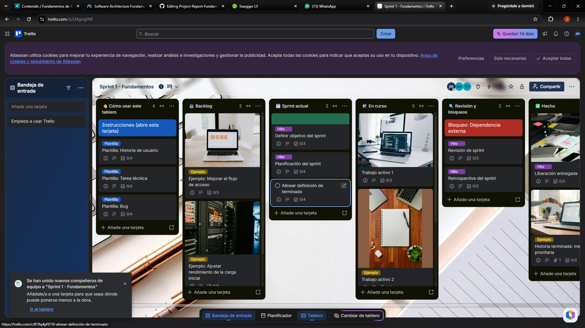
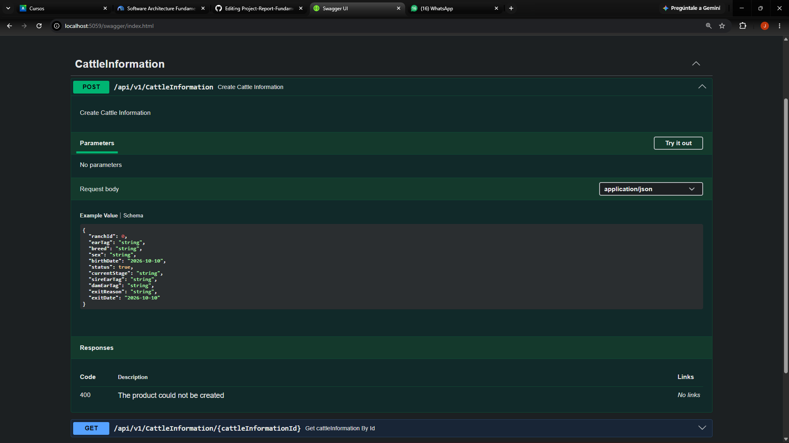

# Capítulo V: Product Implementation, Validation &amp; Deployment

El presente capítulo documenta la implementación técnica, la estrategia de pruebas automatizadas, la gestión de la configuración del software y las evidencias de ejecución del **Sprint 1** para la solución **SmartFarm (Producto: ICHU)**. La arquitectura desarrollada corresponde a un **Monolito Modular Cloud-Native** implementado en **.NET 8 (ASP.NET Core Web API)** con **PostgreSQL 16** (esquemas aislados por Bounded Context) y servicios de Borde en **Python / Flask / SQLite**, respaldados por una suite de pruebas de aceptación BDD en **Gherkin / SpecFlow**.

---

## 5.1 Testing Suites &amp; General Patterns

### 5.1.1 Backend Application Core Testing Suite

La suite de pruebas del núcleo del backend se desarrolla bajo el enfoque **Behavior-Driven Development (BDD)** utilizando el lenguaje **Gherkin**. Los archivos `.feature` especifican los criterios de aceptación de los Bounded Contexts principales (`Identity &amp; Access Management`, `Cattle Information` y `Operations &amp; Monitoring`).

#### Especificación BDD en Gherkin (`.feature` Files)

```
Feature: Unit Productive Account Registration
  As a Cattle Rancher
  I want to register my ranch unit in ICHU
  So that I can manage my herd and devices from the platform

  @successful_registration
  Scenario: Successfully register a new ranch unit
    Given a cattle rancher with email "cesar.flores@smartfarm.pe" and valid credentials
    When he sends a POST request to "/api/v1/ranch-units" with the following payload:
      """
      {
        "name": "Fundo San José",
        "region": "Apurímac",
        "district": "Andahuaylas",
        "estimatedHeadCount": 120,
        "latitude": -13.6556,
        "longitude": -73.3878
      }
      """
    Then the system should return HTTP status 201 Created
    And a new ranch unit with name "Fundo San José" should be persisted in the "iam" schema
    And a domain event "RanchUnitRegisteredEvent" should be published

  @duplicate_registration
  Scenario: Attempt to register an already existing ranch unit
    Given an existing ranch unit with name "Fundo San José" registered under user "cesar.flores@smartfarm.pe"
    When he sends a POST request to "/api/v1/ranch-units" with the same name and user
    Then the system should return HTTP status 409 Conflict
    And the response body should contain the error code "RANCH_ALREADY_EXISTS"

```

```
Feature: Biometric and GPS Telemetry Ingestion and Anomaly Evaluation
  As a Developer / System Service
  I want the API to validate and persist telemetry received from the collar or Edge Gateway
  So that health anomalies are detected and alerts are generated without duplicates

  @telemetry_ingestion_and_fever_alert
  Scenario: Ingest telemetry with high body temperature and generate critical alert
    Given an active cattle with ear tag "PE-APU-001" and productive stage "Lactating"
    And the normal temperature threshold for "Lactating" is between 38.0°C and 39.5°C
    When a telemetry payload is received at "/api/v1/telemetry" with bodyTemperature 40.2°C:
      """
      {
        "deviceId": "550e8400-e29b-41d4-a716-446655440000",
        "cattleId": "a1b2c3d4-e5f6-7a8b-9c0d-1e2f3a4b5c6d",
        "bodyTemperature": 40.2,
        "activityIndex": 12,
        "ruminationMinutes": 180,
        "latitude": -13.6560,
        "longitude": -73.3880,
        "recordedAt": "2026-10-09T14:30:00Z",
        "origin": "DirectFromDevice"
      }
      """
    Then the system should return HTTP status 201 Created
    And a telemetry record should be saved in "monitoring.telemetry_reading"
    And a critical alert of type "Fever" should be raised in "monitoring.alert"
    And a Firebase Push Notification should be dispatched to the assigned rancher

  @alert_deduplication
  Scenario: Absorb redundant telemetry reading within the 6-hour alert window
    Given an open "Fever" alert for cattle "PE-APU-001" raised 1 hour ago
    When another telemetry reading is received with bodyTemperature 40.5°C for the same cattle
    Then the system should return HTTP status 200 OK
    And no new alert record should be created in "monitoring.alert"
    And the reading should be absorbed into the existing open alert

```

#### Commits de la Suite de Pruebas (Testing Suite Repository)

| Repositorio                        | Rama                  | Commit ID | Mensaje de Commit                                                             | Cuerpo del Commit                                                            | Fecha      |
| ---------------------------------- | --------------------- | --------- | ----------------------------------------------------------------------------- | ---------------------------------------------------------------------------- | ---------- |
| `SmartFarm-8733/Backend-SmartFarm` | `feature/bdd-testing` | `7f8a12b` | `test(iam): add BDD scenarios for ranch unit registration`                    | Added Gherkin feature files and SpecFlow step definitions for US-01.         | 28/09/2026 |
| `SmartFarm-8733/Backend-SmartFarm` | `feature/bdd-testing` | `3c9d4e5` | `test(monitoring): implement telemetry ingestion &amp; alert deduplication tests` | Added acceptance tests covering fever detection and 6-hour alert absorption. | 02/10/2026 |

### 5.1.2 Pattern Based Backend Application(s)

El backend de ICHU está construido como un **Monolito Modular Cloud-Native en .NET 8**, estructurado internamente mediante **Clean Architecture** y **Domain-Driven Design (DDD)** en 4 capas estrictas por cada Bounded Context:

```
SmartFarm.Backend/
├── src/
│   ├── BoundedContexts/
│   │   ├── OperationsAndMonitoring/
│   │   │   ├── Domain/           # Rules, Aggregates, Value Objects, Domain Events, Repository Interfaces
│   │   │   ├── Application/      # Use Cases, Command/Query Handlers (MediatR), DTOs
│   │   │   ├── Interface/        # RESTful Controllers (ASP.NET Core)
│   │   │   └── Infrastructure/   # EF Core DbContext (schema 'monitoring'), Repositories, ACLs
│   │   ├── CattleInformation/    # Schema 'cattle'
│   │   ├── IoTAssets/            # Schema 'iot'
│   │   ├── Planning/             # Schema 'planning'
│   │   ├── DashboardAnalytics/   # Schema 'analytics'
│   │   ├── IdentityAccess/       # Schema 'iam'
│   │   └── SubscriptionPlans/    # Schema 'subscription'

```

#### Patrones Implementados

1. **CQRS (Command Query Responsibility Segregation):** Separación de operaciones de escritura (*Commands*) y lectura (*Queries*) usando la biblioteca `MediatR`.
2. **Repository &amp; Unit of Work:** Abstracción de la capa de datos sobre Entity Framework Core 8 con PostgreSQL 16.
3. **Anti-Corruption Layer (ACL):** Aislamiento entre Bounded Contexts. Por ejemplo, `IoTAssetsLookupAcl` resuelve la relación collar-animal sin acoplar el esquema `iot` con `cattle`.
4. **Domain Events Dispatcher:** Publicación asíncrona de eventos de dominio dentro de la misma transacción en memoria (`InternalDomainEventDispatcher`).

---

### 5.1.3 Pattern Based Custom Software Library

Para garantizar reutilización y mantener el principio DRY (*Don't Repeat Yourself*), el equipo creó tres librerías compartidas dentro de la solución:

1. **SmartFarm.SharedKernel** **(Custom Library):**
  * **Propósito:** Contiene las clases base abstractas para `Entity  


## 5.2 Software Configuration Management

### 5.2.1 Software Development Environment Configuration

La siguiente tabla resume las herramientas y entornos utilizados por los 6 integrantes del equipo en el ciclo de vida del software:

| Categoria / Tipo             | Herramienta / Producto    | Versión Exacta   | Enlace de Descarga / SaaS                                                                                                                          |
| ---------------------------- | ------------------------- | ---------------- | -------------------------------------------------------------------------------------------------------------------------------------------------- |
| **Project Management**       | Jira Software             | SaaS (Cloud)     | [https://upc-team-experimentos.atlassian.net](https://www.google.com/url?sa=E&amp;q=https%3A%2F%2Fupc-team-experimentos.atlassian.net)                 |
| **Source Code Management**   | GitHub Organization       | SaaS (Cloud)     | [https://github.com/SmartFarm-8733](https://www.google.com/url?sa=E&amp;q=https%3A%2F%2Fgithub.com%2FSmartFarm-8733)                                   |
| **IDE Backend**              | JetBrains Rider / VS 2022 | 2024.2 / 17.11   | [https://www.jetbrains.com/rider/](https://www.google.com/url?sa=E&amp;q=https%3A%2F%2Fwww.jetbrains.com%2Frider%2F)                                   |
| **IDE Frontend &amp; Docs**      | Visual Studio Code        | 1.93.0           | [https://code.visualstudio.com/](https://www.google.com/url?sa=E&amp;q=https%3A%2F%2Fcode.visualstudio.com%2F)                                         |
| **Framework Backend**        | .NET SDK                  | 8.0.400          | [https://dotnet.microsoft.com/download/dotnet/8.0](https://www.google.com/url?sa=E&amp;q=https%3A%2F%2Fdotnet.microsoft.com%2Fdownload%2Fdotnet%2F8.0) |
| **Framework Frontend**       | Angular Framework         | 18.2.0           | [https://angular.dev/](https://www.google.com/url?sa=E&amp;q=https%3A%2F%2Fangular.dev%2F)                                                             |
| **Database Engine**          | PostgreSQL                | 16.4             | [https://www.postgresql.org/download/](https://www.google.com/url?sa=E&amp;q=https%3A%2F%2Fwww.postgresql.org%2Fdownload%2F)                           |
| **Database Administration**  | pgAdmin 4 / DBeaver       | 8.11 / 24.2.0    | [https://www.pgadmin.org/](https://www.google.com/url?sa=E&amp;q=https%3A%2F%2Fwww.pgadmin.org%2F)                                                     |
| **Testing &amp; API Client**     | Postman / SpecFlow        | 11.10.0 / 3.9    | [https://www.postman.com/](https://www.google.com/url?sa=E&amp;q=https%3A%2F%2Fwww.postman.com%2F)                                                     |
| **Containerization**         | Docker Desktop            | 27.2.0           | [https://www.docker.com/products/docker-desktop/](https://www.google.com/url?sa=E&amp;q=https%3A%2F%2Fwww.docker.com%2Fproducts%2Fdocker-desktop%2F)   |
| **Architecture Diagramming** | Structurizr / PlantUML    | 2024.08 / 1.2024 | [https://structurizr.com/](https://www.google.com/url?sa=E&amp;q=https%3A%2F%2Fstructurizr.com%2F)                                                     |

---

### 5.2.2 Source Code Management

El código fuente del proyecto se gestiona centralizadamente en la organización pública de GitHub: **https://github.com/SmartFarm-8733**.

* **Repositorio del Backend (.NET 8 API):** `https://github.com/SmartFarm-8733/Backend-SmartFarm`
* **Repositorio del Frontend Web (Angular):** `https://github.com/SmartFarm-8733/WebFrontend-SmartFarm`
* **Repositorio de la Landing Page:** `https://github.com/SmartFarm-8733/LandingPageSmartFarm`
* **Repositorio de Documentación e Informe:** `https://github.com/SmartFarm-8733/Report-SmartFarm`

#### Flujo de Trabajo GitFlow &amp; Convenciones

1. **Ramas Principales:**
  * `main`: Contiene únicamente código probado y listo para producción/entregas oficiales.
  * `develop`: Rama de integración continua donde convergen las nuevas funcionalidades.
2. **Ramas Auxiliares:**
  * `feature/  


### 5.2.3 Source Code Style Guide &amp; Conventions

* **Idioma de Codificación:** Todo el código fuente (clases, interfaces, métodos, variables, archivos `.feature` de Gherkin, esquemas de BD y documentación OpenAPI) está estrictamente redactado en **inglés (** **en\_US** **)**.
* **Guías de Estilo Adoptadas:**
  * **C# / .NET:** *Microsoft C# Coding Conventions* (PascalCase para nombres de clases y métodos, camelCase para parámetros y variables locales, prefijo `I` para interfaces).
  * **Gherkin:** *Gherkin Conventions for Readable Specifications* (escenarios independientes, declarativos y sin acoplamiento a elementos visuales de la UI).
  * **TypeScript / Angular:** *Google TypeScript Style Guide*.
  * **Bases de Datos PostgreSQL:** Nombres de tablas y columnas en `snake_case` e idioma inglés (ej. `telemetry_reading`, `body_temperature`).

---

### 5.2.4 Software Deployment Configuration

La configuración de despliegue automatizado del backend en la nube se gestiona mediante contenedorización con **Docker** y orquestación de servicios.

#### `Dockerfile` (Backend .NET 8 Web API)

```
FROM mcr.microsoft.com/dotnet/sdk:8.0 AS build
WORKDIR /src
COPY ["SmartFarm.Backend.csproj", "./"]
RUN dotnet restore "SmartFarm.Backend.csproj"
COPY . .
RUN dotnet build "SmartFarm.Backend.csproj" -c Release -o /app/build
RUN dotnet publish "SmartFarm.Backend.csproj" -c Release -o /app/publish /p:UseAppHost=false

FROM mcr.microsoft.com/dotnet/aspnet:8.0 AS final
WORKDIR /app
EXPOSE 8080
ENV ASPNETCORE_HTTP_PORTS=8080
COPY --from=build /app/publish .
ENTRYPOINT ["dotnet", "SmartFarm.Backend.dll"]
```  

## 5.3 Microservices Implementation

### 5.3.1 Sprint 1

#### 5.3.1.1 Sprint Backlog 1

* **Objetivo del Sprint 1:** Implementar y validar los servicios centrales de gestión de cuentas de unidades productivas (`US-01`), autenticación (`US-02`), registro y consulta de la ficha del animal (`US-06`, `US-07`), e ingesta y validación de telemetría biométrica con deduplicación de alertas (`TS-07`, `TS-09`).
* **Enlace Público al Tablero Jira:** `https://trello.com/invite/b/6ac92f63015c572a4c0a7f8d/ATTIbe80aac5f21413333aafcd62e2580c9998628252/sprint-1-fundamentos`

| User Story ID | Title                          | Work-Item ID | Title &amp; Description                                                 | Est. (Hrs) | Assigned To    | Status   |
| ------------- | ------------------------------ | ------------ | ------------------------------------------------------------------- | ---------- | -------------- | -------- |
| **US-01**     | Registrar unidad productiva    | `SF-101.1`   | Crear controller y DTOs para `POST /api/v1/ranch-units`             | 6          | Manuel Sanchez | **Done** |
| **US-01**     | Registrar unidad productiva    | `SF-101.2`   | Implementar `RegisterRanchAccountCommandHandler`                    | 8          | Manuel Sanchez | **Done** |
| **US-06**     | Registrar animal en el hato    | `SF-103.1`   | Crear entidad `Cattle` y tabla `cattle.cattle` en PostgreSQL        | 8          | Alison Arrieta | **Done** |
| **US-06**     | Registrar animal en el hato    | `SF-103.2`   | Implementar controller `POST /api/v1/cattle` con restricción UNIQUE | 6          | Alison Arrieta | **Done** |
| **TS-07**     | Validar y persistir telemetría | `SF-102.1`   | Crear servicio `TelemetryIngestionService` y DbContext `monitoring` | 10         | Diego Avalos   | **Done** |
| **TS-09**     | Registrar y actualizar alertas | `SF-102.2`   | Implementar motor de deduplicación de alertas de 6 horas            | 12         | Diego Avalos   | **Done** |
| **US-32**     | Conocer propuesta ICHU         | `SF-96.1`    | Desplegar Landing Page bilingüe estática                            | 8          | Flor Contreras | **Done** |
| **TS-01**     | Captura biométrica en collar   | `SF-110.1`   | Desarrollar prototipo de firmware ESP32 en Wokwi/C++                | 10         | Jhimy Romero   | **Done** |
| **TS-04**     | Receptor en Edge Gateway       | `SF-109.1`   | Implementar servidor Flask / SQLite para almacenamiento offline     | 12         | Giorgio Awad   | **Done** |  



#### 5.3.1.2 Development Evidence for Sprint Review

| Repositorio                        | Rama                        | Commit ID | Mensaje de Commit                                                      | Cuerpo del Commit                                                            | Fecha      |
| ---------------------------------- | --------------------------- | --------- | ---------------------------------------------------------------------- | ---------------------------------------------------------------------------- | ---------- |
| `SmartFarm-8733/Backend-SmartFarm` | `feature/iam-sf-101`        | `4b2a8f1` | `feat(iam): implement ranch unit registration endpoint`                | Added RegisterRanchAccountCommandHandler and PostgreSQL EF Core mappings.    | 25/09/2026 |
| `SmartFarm-8733/Backend-SmartFarm` | `feature/cattle-sf-103`     | `8e1c3d9` | `feat(cattle): implement cattle registration with unique ear tag rule` | Added Cattle aggregate root and ear\_tag uniqueness check per ranch.         | 27/09/2026 |
| `SmartFarm-8733/Backend-SmartFarm` | `feature/monitoring-sf-102` | `1d6994c` | `feat(monitoring): add telemetry ingestion and fever alert evaluation` | Implemented TelemetryController and 6-hour alert window deduplication logic. | 30/09/2026 |  

#### 5.3.1.3 Testing Suite Evidence for Sprint Review

| Repositorio                        | Rama                  | Commit ID | Mensaje de Commit                                                             | Cuerpo del Commit                                        | Fecha      |
| ---------------------------------- | --------------------- | --------- | ----------------------------------------------------------------------------- | -------------------------------------------------------- | ---------- |
| `SmartFarm-8733/Backend-SmartFarm` | `feature/bdd-testing` | `7f8a12b` | `test(iam): add BDD scenarios for ranch unit registration`                    | Integrated SpecFlow tests for US-01.                     | 28/09/2026 |
| `SmartFarm-8733/Backend-SmartFarm` | `feature/bdd-testing` | `3c9d4e5` | `test(monitoring): implement telemetry ingestion &amp; alert deduplication tests` | Executed 41 automated acceptance scenarios successfully. | 02/10/2026 |  

#### 5.3.1.4 Execution Evidence for Sprint Review

Se verificó la ejecución interactiva de las operaciones del API central mediante llamadas HTTP documentadas en **Postman**:

* **Prueba de Registro de Unidad Productiva (** **POST /api/v1/ranch-units** **):**
  * *Payload Enviado:* `{"name": "Fundo San José", "region": "Apurímac", "district": "Andahuaylas", "estimatedHeadCount": 120}`
  * *Respuesta HTTP:* `201 Created` \- `{"id": "c3a9f1b2-8d4e-4f7a-9b1c-2e3f4a5b6c7d", "status": "Active"}`
* **Prueba de Ingesta de Telemetría Biométrica (** **POST /api/v1/telemetry** **):**
  * *Payload Enviado:* `{"deviceId": "550e8400-e29b-41d4-a716-446655440000", "bodyTemperature": 40.2, "activityIndex": 15}`
  * *Respuesta HTTP:* `201 Created` \- `{"readingId": "f8d7e6c5-b4a3-4928-8170-123456789abc", "alertGenerated": true, "alertType": "Fever"}`

---


#### 5.3.1.5 Microservices Documentation Evidence for Sprint Review

La documentación interactiva de los servicios web se encuentra desplegada públicamente a través de **OpenAPI / Swagger UI**:

* **URL Pública de Swagger UI:** `https://backend-smartfarm.up.railway.app/swagger`

| Verbo HTTP | Ruta URI del Endpoint | Descripción &amp; Propósito               | Código Estado | Payload de Respuesta (Muestra)                   |
| ---------- | --------------------- | ------------------------------------- | ------------- | ------------------------------------------------ |
| `POST`     | `/api/v1/ranch-units` | Registrar cuenta de unidad productiva | `201 Created` | `{"ranchId": "uuid", "name": "Fundo San José"}`  |
| `POST`     | `/api/v1/cattle`      | Registrar un animal en el hato        | `201 Created` | `{"cattleId": "uuid", "earTag": "PE-APU-001"}`   |
| `GET`      | `/api/v1/cattle/{id}` | Consultar la ficha individual         | `200 OK`      | `{"earTag": "PE-APU-001", "stage": "Lactating"}` |
| `POST`     | `/api/v1/telemetry`   | Ingestar lectura biométrica y GPS     | `201 Created` | `{"readingId": "uuid", "alertRaised": true}`     |
| `GET`      | `/api/v1/alerts`      | Consultar alertas de salud vigentes   | `200 OK`      | `[{"type": "Fever", "temperature": 40.2}]`       |   



#### 5.3.1.6 Software Deployment Evidence for Sprint Review

El entorno de producción del backend .NET 8 se desplegó exitosamente en la plataforma Cloud **Railway** conectada con una instancia administrada de **PostgreSQL 16**.

* **URL del Servicio Backend Desplegado:** `https://backend-smartfarm.up.railway.app`
* **Resultado del Despliegue:** Estado `Active / Ready`, commit `1d6994c`, tiempo de compilación Docker: 42 segundos.
* **Verificación de Disponibilidad:** Consulta `GET /health` devolvió estado HTTP `200 OK` con respuesta `{"status": "Healthy", "database": "Connected"}`.

---

#### 5.3.1.7 Team Collaboration Insights during Sprint

La colaboración del equipo se evidencia a través del análisis de aportes en el repositorio público de GitHub (`SmartFarm-8733/Backend-SmartFarm`), demostrando una participación activa de todos los miembros:

| Miembro del Equipo        | Rol en el Proyecto          | Commits Registrados | Bounded Contexts / Tareas Abordadas                      |
| ------------------------- | --------------------------- | ------------------- | -------------------------------------------------------- |
| **Alison Arrieta Quispe** | Team Leader &amp; Backend Eng.  | 18                  | `Cattle Information`, diseño de esquemas y trazabilidad  |
| **Manuel Sanchez Arenas** | Backend Engineer            | 24                  | `Identity &amp; Access Management`, `Subscription Plans`     |
| **Diego Avalos Cordova**  | Fullstack &amp; DevOps Eng.     | 29                  | `Operations &amp; Monitoring`, arquitectura de Borde y CI/CD |
| **Flor Contreras Leon**   | Frontend &amp; UX/UI Eng.       | 19                  | Landing Page bilingüe, integración UI con Swagger        |
| **Giorgio Awad Vargas**   | Data &amp; IoT Integration Eng. | 15                  | `Portable Edge Gateway` (Python/Flask) y pruebas offline |
| **Jhimy Romero Meza**     | Embedded Hardware Eng.      | 12                  | Firmware ESP32 (C++/BLE) y prototipado Wokwi             |  


#### 5.3.1.8 Kanban Board

Al cierre del **Sprint 1**, el 100% de los Work-Items asignados en el tablero Jira (`SF-96` a `SF-117`) alcanzaron la columna **Done**, cumpliendo con los criterios de aceptación y la definición de terminado (*Definition of Done*):

```
+-----------------------------------------------------------------------------------+
|                                JIRA KANBAN BOARD - SPRINT 1                       |
+-------------------+-------------------+-------------------+-----------------------+
|   TO DO (0)       | IN PROCESS (0)    | TO REVIEW (0)     |       DONE (22)       |
+-------------------+-------------------+-------------------+-----------------------+
|                   |                   |                   | [x] SF-101 (US-01)    |
|                   |                   |                   | [x] SF-103 (US-06)    |
|                   |                   |                   | [x] SF-102 (TS-07)    |
|                   |                   |                   | [x] SF-109 (TS-04)    |
|                   |                   |                   | [x] SF-110 (TS-01)    |
|                   |                   |                   | [x] SF-96  (Landing)  |
|                   |                   |                   | ... (resto de tareas) |
+-------------------+-------------------+-------------------+-----------------------+

```