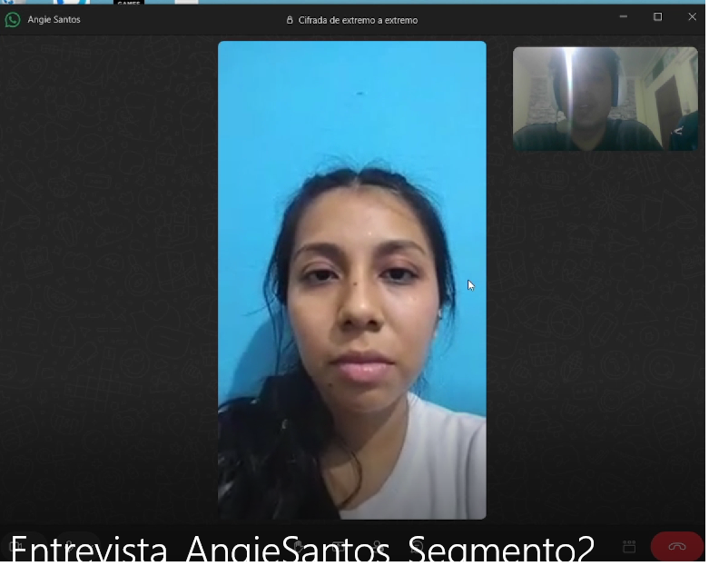
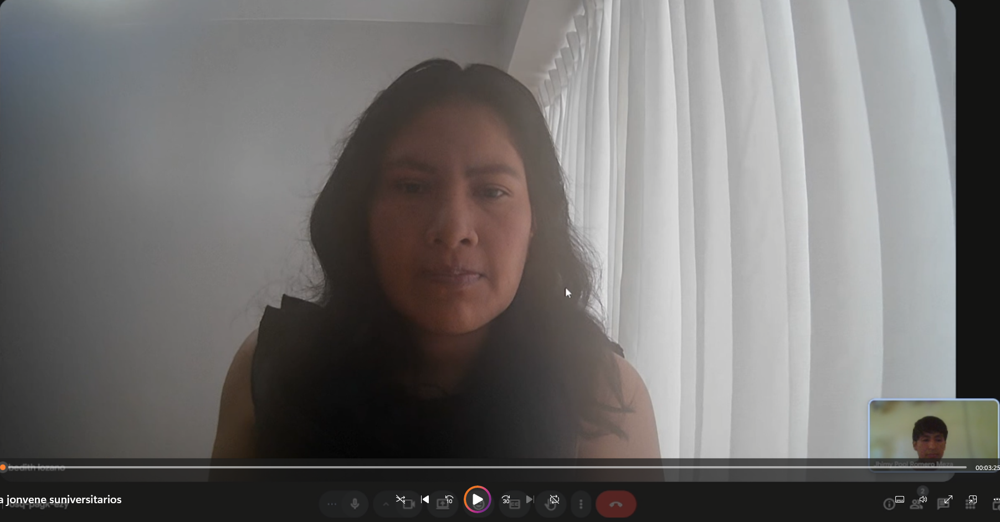
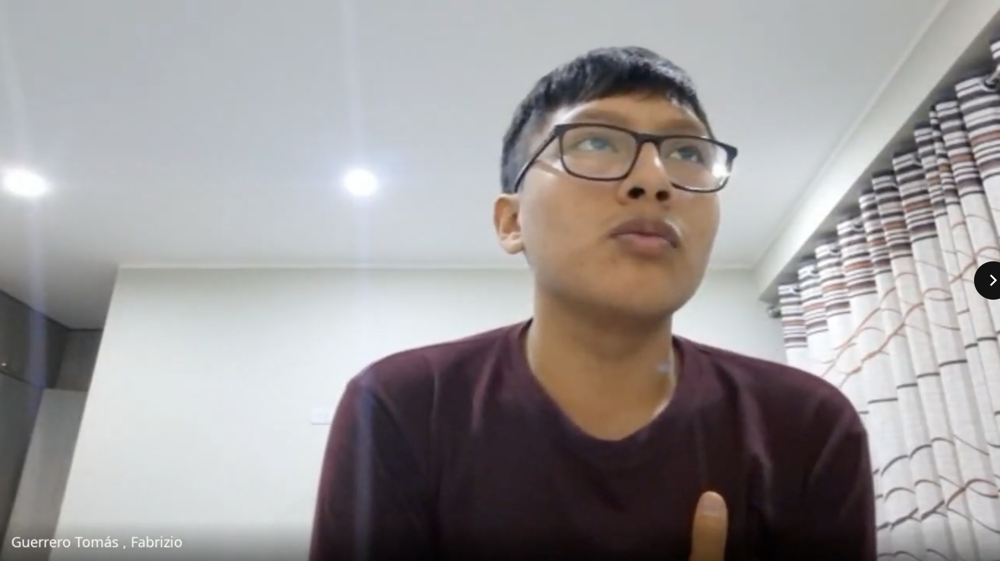
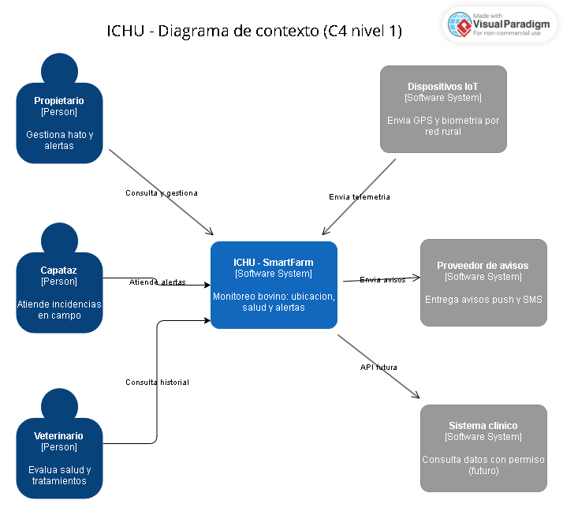
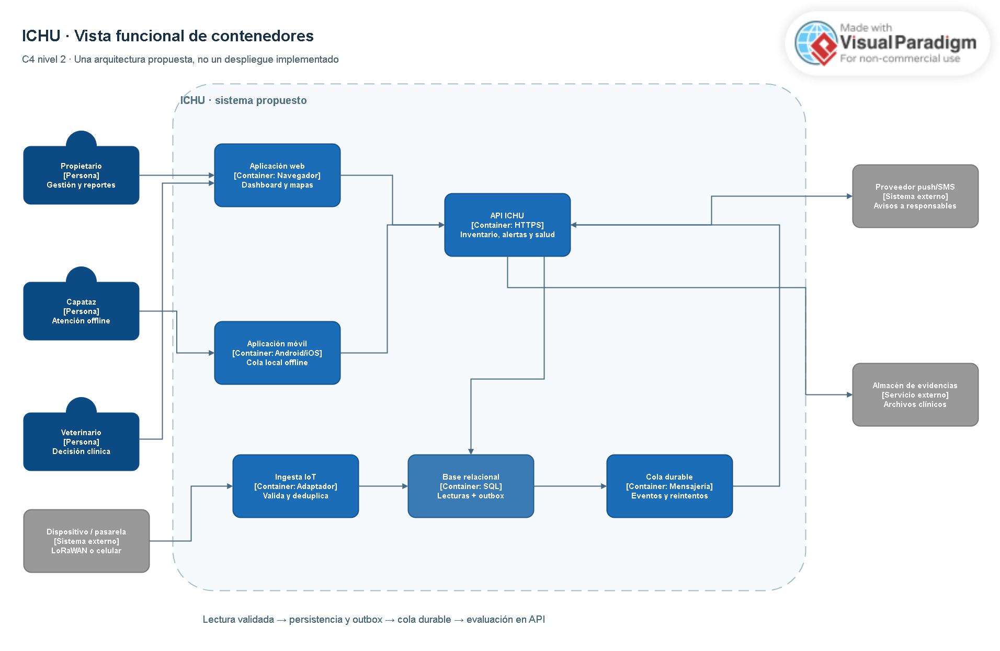
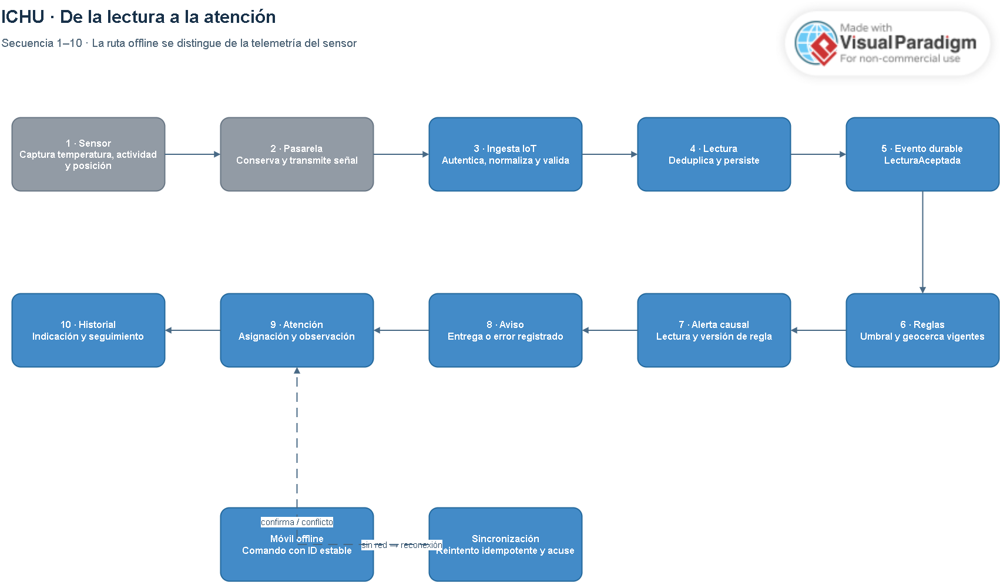
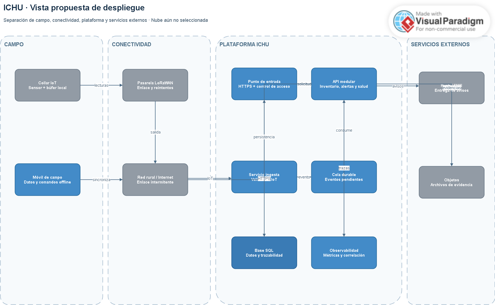
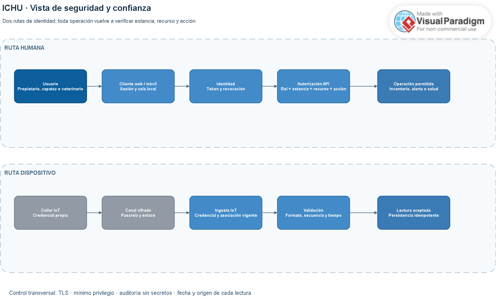
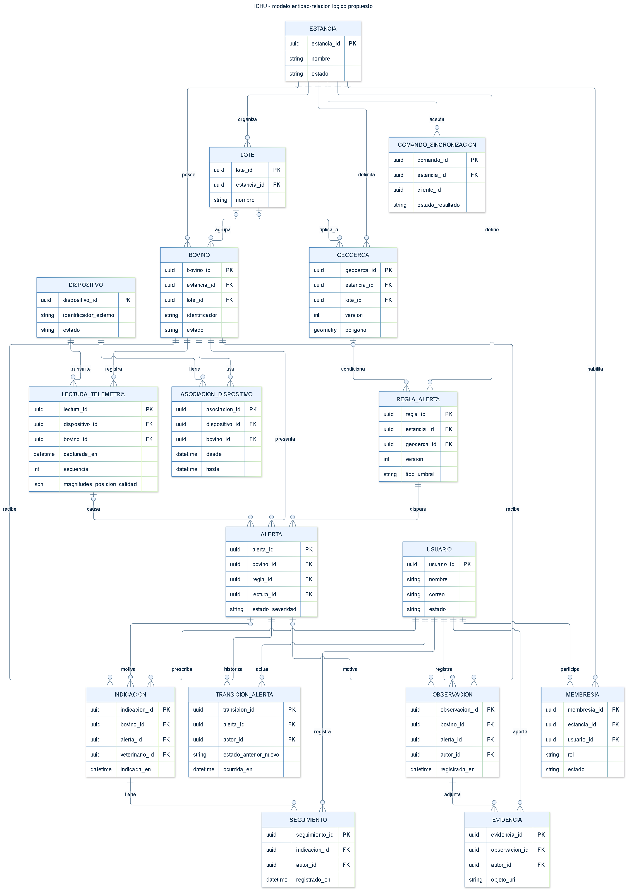

<p style="text-align: center">
  
</p>
<h2 style="text-align: center">Universidad Peruana de Ciencias Aplicadas</h2>  
<h3 style="text-align: center"> Ingeniería de Software</h3>  


<p style="text-align: center"><strong>Fundamentos de Arquitectura de Software</strong> </p>  
<p style="text-align: center"><strong>202620</strong> </p> 
<p style="text-align: center"><strong>NRC:</strong> 8733</p>  
<p style="text-align: center"><strong>Profesor:</strong> Jorge Luis Delgado Vite</p>

<h1 style="text-align: center">Informe de Trabajo Final</h1>

<p style="text-align: center"><strong>Nombre del Producto:</strong> SmartFarm</p>

## Integrantes
<table style="width: 100%; border-collapse: collapse;">
  <thead>
    <tr>
      <th style="border: 1px solid #888; padding: 8px; background-color: #1e1e1e;">Código</th>
      <th style="border: 1px solid #888; padding: 8px; background-color: #1e1e1e;">AlUMNO</th>
    </tr>
  </thead>
  <tbody>
      <td style="border: 1px solid #888; padding: 8px;">U202417693</td>
      <td style="border: 1px solid #888; padding: 8px;">Alexander Auden Aliaga Ocampo</td>
    </tr>
    <tr>
      <td style="border: 1px solid #888; padding: 8px;">U202321510</td>
      <td style="border: 1px solid #888; padding: 8px;">Meza Jhimy Pool, Romero</td>
    </tr>
    <tr>
      <td style="border: 1px solid #888; padding: 8px;">U202412591</td>
      <td style="border: 1px solid #888; padding: 8px;">Diego Vicente Seminario Castillo</td>
    </tr>
  </tbody>
</table>


---

<p style="text-align: center"><strong>Septiembre - 2026</strong></p>

---


# Registro de Versiones del Informe
| Versión | Fecha   | Autor     | Descripción de modificación |
|---------|---------|-----------|-----------------------------|
| v1.0.0  | 9/12/26 | SmartFarm | TB1                         |

# Student Outcome ABET

El curso contribuye al cumplimiento del *Student Outcome ABET*:

**ABET - EAC - Student Outcome 7: Aprendizaje continuo y autónomo**

**Criterio:** capacidad de adquirir y aplicar nuevos conocimientos según sea necesario, utilizando estrategias de aprendizaje apropiadas.

En el siguiente cuadro se describen las acciones y conclusiones del equipo durante el **TB1**, que sustentan el logro del Student Outcome.

| Criterio específico | Acciones realizadas - TB1 | Conclusiones |
|---|---|---|
| *Actualiza conceptos y conocimientos necesarios para su desarrollo profesional y, en especial, para su proyecto en soluciones de software.* | **Alexander Auden Aliaga Ocampo**<br><br>Investigó y aplicó conceptos de *Requirements Elicitation*, *Needfinding*, User Personas, User Task Matrix y técnicas de entrevistas para estructurar los requisitos de SmartFarm.<br><br>**Jhimy Pool Romero Meza**<br><br>Profundizó en Lean UX, Scenario Mapping y diseño centrado en el usuario para relacionar los problemas del sector ganadero con funcionalidades de la solución.<br><br>**Diego Vicente Seminario Castillo**<br><br>Actualizó conocimientos sobre IoT aplicado al monitoreo ganadero, telemetría, alertas y trazabilidad para sustentar la propuesta tecnológica de SmartFarm. | Durante el TB1, el equipo incorporó y aplicó conocimientos de investigación de usuarios, Lean UX e IoT para definir una solución coherente con las necesidades de propietarios, operarios de campo y veterinarios. |
| *Reconoce la necesidad del aprendizaje permanente para el desempeño profesional y el desarrollo de proyectos en soluciones de software.* | **Alexander Auden Aliaga Ocampo**<br><br>Contrastó la propuesta con competidores y registró hallazgos de entrevistas para identificar mejoras y requisitos pendientes.<br><br>**Jhimy Pool Romero Meza**<br><br>Participó en la revisión y refinamiento de los artefactos de análisis, identificando la importancia de validar continuamente las decisiones de diseño.<br><br>**Diego Vicente Seminario Castillo**<br><br>Analizó los cambios tecnológicos y operativos que afectan a la ganadería inteligente para reconocer nuevas necesidades de aprendizaje en el proyecto. | El equipo reconoce que el proyecto requiere aprendizaje continuo: los requisitos, la conectividad rural y las tecnologías IoT deben revisarse y validarse de forma iterativa antes de cada avance. |

# Tabla de contenidos
# CONTENIDO

**STUDENT OUTCOME**

**CAPÍTULO I: Introducción**

1.1. Startup Profile

1.1.1. Descripción del Startup

1.1.2. Perfiles de integrantes del equipo

1.2. Solution Profile

1.2.1. Nombre de producto

1.2.2. Antecedentes y Problemática

1.2.3. Lean UX Process

1.2.3.1. Lean UX Problem Statement

1.2.3.2. Lean UX Assumptions

1.2.3.3. Lean UX Hypothesis

1.2.3.4. Lean UX Canvas

1.3. Segmentos objetivo

**CAPÍTULO II: Requirements Elicitation & Analysis**

2.1. Competidores

2.1.1. Análisis Competitivo

2.1.2. Estrategias y tácticas frente a competidores

2.2. Entrevistas

2.2.1. Diseño de Entrevistas

2.2.2. Registro de Entrevistas

2.2.3. Análisis de Entrevistas

2.3. NeedFinding

2.3.1. User Personas

2.3.2. User Task Matrix

2.3.3. Empathy Maps

2.3.4. As-Is Scenario Mapping

**CAPÍTULO III: Requirements Elicitation & Analysis**

3.1. To-Be Scenario Mapping

3.2. User Stories

3.3. Impact Map

3.4. Product Backlog

**CAPÍTULO IV: Product Architecture Design**

4.1. Design Concepts, ViewPoints & ER Diagrams

4.1.1. Principles Statements

4.1.2. Approaches Statements Architectural Styles & Patterns

4.1.3. Context Diagram

4.1.4. Approach Driven ViewPoints Diagrams

4.1.5. Relational/Non Relational Database Diagram

4.1.6. Design Patterns

4.1.7. Tactics

4.2. Architectural Drivers

4.2.1. Design Purpose

4.2.2. Primary Functionality (Primary User Stories)

4.2.3. Quality Attribute Scenarios

4.2.4. Constraints

4.2.5. Architectural Concerns

4.3. ADD Iterations

4.3.1. Iteration 1: Global System Structure

4.3.1.1. Architectural Design Backlog 1

4.3.1.2. Establish Iteration Goal by Selecting Drivers

4.3.1.3. Choose One or More Elements of the System to Refine

4.3.1.4. Choose One or More Design Concepts That Satisfy the Selected Drivers

4.3.1.5. Instantiate Architectural Elements, Allocate Responsibilities, and Define Interfaces

4.3.1.6. Sketch Views (C4 & UML) and Record Design Decisions

4.3.1.7. Analysis of Current Design and Review Iteration Goal (Kanban Board)

4.3.2. Iteration 2: Sincronización Edge-to-Cloud y Pipeline de Telemetría

4.3.2.1. Architectural Design Backlog 2

4.3.2.2. Establish Iteration Goal by Selecting Drivers

4.3.2.3. Choose One or More Elements of the System to Refine

4.3.2.4. Choose One or More Design Concepts That Satisfy the Selected Drivers

4.3.2.5. Instantiate Architectural Elements, Allocate Responsibilities, and Define Interfaces

4.3.2.6. Sketch Views (C4 & UML) and Record Design Decisions

4.3.2.7. Analysis of Current Design and Review Iteration Goal (Kanban Board)

4.3.3. Iteration 3: Orquestación del Ciclo de Riego Autónomo e Integración con el Edge

4.3.3.1. Architectural Design Backlog 3

4.3.3.2. Establish Iteration Goal by Selecting Drivers

4.3.3.3. Choose One or More Elements of the System to Refine

4.3.3.4. Choose One or More Design Concepts That Satisfy the Selected Drivers

4.3.3.5. Instantiate Architectural Elements, Allocate Responsibilities, and Define Interfaces

4.3.3.6. Sketch Views (C4 & UML) and Record Design Decisions

4.3.3.7. Analysis of Current Design and Review Iteration Goal (Kanban Board)

4.3.4. Iteration 4: Seguridad e Identidad

4.3.4.1. Architectural Design Backlog 4

4.3.4.2. Establish Iteration Goal by Selecting Drivers

4.3.4.3. Choose One or More Elements of the System to Refine

4.3.4.4. Choose One or More Design Concepts That Satisfy the Selected Drivers

4.3.4.5. Instantiate Architectural Elements, Allocate Responsibilities, and Define Interfaces

4.3.4.6. Sketch Views (C4 & UML) and Record Design Decisions

4.3.4.7. Analysis of Current Design and Review Iteration Goal (Kanban Board)

4.3.5. Iteration 5: Refinamiento del Crop Analysis Service y Diagnóstico de Cultivos

4.3.5.1. Architectural Design Backlog 5

4.3.5.2. Establish Iteration Goal by Selecting Drivers

4.3.5.3. Choose One or More Elements of the System to Refine

4.3.5.4. Choose One or More Design Concepts That Satisfy the Selected Drivers

4.3.5.5. Instantiate Architectural Elements, Allocate Responsibilities, and Define Interfaces

4.3.5.6. Sketch Views (C4 & UML) and Record Design Decisions

4.3.5.7. Analysis of Current Design and Review Iteration Goal (Kanban Board)

**CAPÍTULO V: Product Implementation, Validation & Deployment**

5.1. Testing Suites & General Patterns

5.1.1. Backend Application Core Testing Suite

5.1.2. Pattern Based Backend Application(s)

5.1.3. Pattern Based Custom Software Library

5.1.4. Framework Pattern Driven Refactoring Report

5.2. Software Configuration Management

5.2.1. Software Development Environment Configuration

5.2.2. Source Code Management

5.2.3. Source Code Style Guide & Conventions

5.2.4. Software Deployment Configuration

5.3. MicroServices Implementation

5.3.1. Sprint 1

5.3.1.1. Sprint Backlog 1

5.3.1.2. Development Evidence for Sprint Review

5.3.1.3. Testing Suite Evidence for Sprint Review

5.3.1.4. Execution Evidence for Sprint Review

5.3.1.5. Microservices Documentation Evidence for Sprint Review

5.3.1.6. Software Deployment Evidence for Sprint Review

5.3.1.7. Team Collaboration Insights during Sprint

5.3.1.8. Kanban Board

5.3.2. Sprint 2

5.3.2.1. Sprint Backlog 2

5.3.2.2. Development Evidence for Sprint Review

5.3.2.3. Testing Suite Evidence for Sprint Review

5.3.2.4. Execution Evidence for Sprint Review

5.3.2.5. Microservices Documentation Evidence for Sprint Review

5.3.2.6. Software Deployment Evidence for Sprint Review

5.3.2.7. Team Collaboration Insights During Sprint

5.3.2.8. Kanban Board

5.3.3. Sprint 3

5.3.3.1. Sprint Backlog 3

5.3.3.2. Development Evidence for Sprint Review

5.3.3.3. Testing Suite Evidence for Sprint Review

5.3.3.4. Execution Evidence for Sprint Review

5.3.3.5. Microservices Documentation Evidence for Sprint Review

5.3.3.6. Software Deployment Evidence for Sprint Review

5.3.3.7. Team Collaboration Insights During Sprint

5.3.3.8. Kanban Board

5.3.4. Sprint 4

5.3.4.1. Sprint Backlog 4

5.3.4.2. Development Evidence for Sprint Review

5.3.4.3. Testing Suite Evidence for Sprint Review

5.3.4.4. Execution Evidence for Sprint Review

5.3.4.5. Microservices Documentation Evidence for Sprint Review

5.3.4.6. Software Deployment Evidence for Sprint Review

5.3.4.7. Team Collaboration Insights During Sprint

5.3.4.8. Kanban Board

5.4. MicroServices Deployment

5.4.1. Cloud Architecture Diagrams

5.4.2. Cloud Architecture Deployment

**Conclusiones**

**Recomendaciones**

**Bibliografía**

**Anexos**

**Links**
# Capítulo I: Introducción

## 1.1. Startup Profile

### 1.1.1. Descripción de la Startup

La startup es una empresa de base tecnológica orientada al sector ganadero, cuyo propósito es brindar una solución digital que permita a los ganaderos mejorar la gestión, monitoreo y cuidado de su ganado mediante el uso de tecnologías como Internet de las Cosas (IoT), dispositivos inteligentes y aplicaciones móviles. La propuesta busca facilitar el acceso a información relevante sobre el estado y comportamiento de los animales, permitiendo que los ganaderos puedan tomar decisiones de manera más rápida y eficiente.

La solución estará conformada principalmente por una aplicación móvil y una plataforma digital que recibirán información recopilada mediante dispositivos IoT colocados en los animales, como collares o aretes inteligentes. Estos dispositivos permitirán registrar datos relacionados con la actividad, ubicación, comportamiento y posibles cambios en el estado del animal. La información será procesada y presentada de manera sencilla al ganadero, permitiéndole realizar un seguimiento individual de cada animal y de su ganado en general.

De esta manera, la startup busca contribuir a la modernización de la actividad ganadera mediante una herramienta tecnológica que centralice la información de los animales y facilite su monitoreo. La solución permitirá identificar oportunamente situaciones que puedan requerir atención, optimizar las actividades de manejo del ganado y contar con un historial de información que apoye la toma de decisiones. Asimismo, la propuesta busca reducir la dependencia de controles manuales y mejorar la eficiencia en la gestión de las unidades ganaderas.

### 1.1.2. Perfiles de integrantes del equipo

| Integrantes | Foto | Descripción del perfil |
|---|---|---|
| Seminario Castillo,Diego Vicente<br>U202412951 |  | Estudiante de Ingeniería de Software con interés en el análisis, diseño y desarrollo de soluciones tecnológicas. Se caracteriza por su organización, capacidad de adaptación y disposición para colaborar en equipo. |
| Aliaga Ocampo, Alexander Auden<br>U202417693 |  | Estudiante de Ingeniería de Software con interés en el diseño de soluciones tecnológicas y la arquitectura de software. Se caracteriza por su compromiso, aprendizaje continuo y colaboración en equipo durante el desarrollo de proyectos. |
| Romero Meza, Jhimy Pool<br>U202321510 |  | Estudiante de Ingeniería de Software (5mo ciclo). Se destaca por su responsabilidad, compromiso y disposición constante para colaborar. Cuenta con conocimientos previos en tecnología y en el desarrollo de proyectos, demostrando iniciativa y capacidad de aprendizaje autónomo. |

## 1.2. Solution Profile

### 1.2.1. Nombre del producto

### 1.2.2. Antecedentes y problemática

La ganadería es una de las actividades económicas y de sustento alimentario más antiguas y cruciales del mundo. Históricamente, la gestión de las unidades ganaderas se ha basado en procesos tradicionales y controles estrictamente manuales. El monitoreo del ganado en grandes extensiones de terreno siempre ha presentado enormes dificultades logísticas, requiriendo patrullajes físicos diarios por parte de los operarios para verificar visualmente el estado de salud, la ubicación y el comportamiento de cada animal.

En el contexto actual de la industria agropecuaria, el auge de tecnologías disruptivas ha abierto las puertas a la ganadería inteligente (Smart Farming). El uso de sensores de bajo costo, redes inalámbricas de largo alcance (como LoRaWAN), plataformas en la nube y dispositivos móviles permite capturar parámetros biométricos y de comportamiento en tiempo real. Esto permite transformar un modelo de gestión reactivo donde un problema médico o una pérdida de animal se detecta cuando ya es demasiado tarde en un modelo predictivo y de monitoreo preventivo constante.

**Descripción de la Problemática (Análisis 5W2H)**
Para estructurar de manera precisa las dimensiones del problema que enfrenta nuestro sector objetivo, se aplica la técnica de análisis 5W2H (Who, What, Where, When, Why, How, How Much):

Who (¿Quién está afectado?): Los principales afectados son los ganaderos de medianas y grandes unidades de producción pecuaria, administradores de ranchos, operarios de campo y veterinarios. Estos actores carecen de visibilidad en tiempo real sobre la salud y la ubicación de sus animales de manera individualizada, lo que dificulta una supervisión efectiva y aumenta su carga de trabajo operativa.

What (¿Cuál es el problema?): El problema central es la ineficiencia y la falta de control oportuno en el monitoreo diario del ganado. Esto se traduce en la detección tardía de enfermedades crónicas, demoras en la identificación de ciclos reproductivos críticos (como el celo) y una alta vulnerabilidad ante pérdidas físicas por robo (abigeato) o extravío de animales en terrenos de pastoreo abiertos.

Where (¿Dónde ocurre el problema?): El problema se manifiesta directamente en las unidades ganaderas de pastoreo y establos ubicados en zonas rurales o semi-rurales, caracterizadas por su gran extensión geográfica, relieves complejos y, en muchos casos, cobertura limitada de redes de telecomunicaciones tradicionales.

When (¿Cuándo ocurre el problema?): Ocurre de forma continua, pero se torna crítico bajo escenarios específicos: durante las horas de la noche (cuando es más probable el robo de animales o ataques de depredadores), en las temporadas de brotes epidemiológicos donde el contagio silencioso puede diezmar un establo, y durante los periodos de celo o partos inminentes que exigen intervención humana inmediata.

Why (¿Por qué ocurre el problema?): La causa principal es la persistencia de métodos de supervisión manual y reactivos debido a la escasez de soluciones tecnológicas accesibles, integradas y centralizadas en el campo ganadero. Los registros manuales en papel u hojas de cálculo locales no proporcionan telemetría en tiempo real, lo que impide generar alertas automáticas ante comportamientos anómalos de los animales.

How (¿Cómo se manifiesta y qué impacto tiene?): Se manifiesta en una reacción tardía ante emergencias. Cuando un ganadero o veterinario detecta visualmente que un animal está gravemente enfermo o ha sido robado, habitualmente ya han transcurrido horas o días desde el inicio del evento. Esto resulta en muertes evitables de ganado, un incremento drástico en los costos de tratamientos veterinarios de emergencia y la pérdida irrecuperable de activos de alto valor genético.

How Much (¿Cuánto cuesta este problema?): Se estima que las muertes prevenibles de animales y las ineficiencias en el control de ciclos reproductivos generan pérdidas financieras de entre el 10% y el 20% de la productividad anual de la unidad ganadera. Además, los costos operativos dedicados exclusivamente al patrullaje manual diario de grandes parcelas incrementan significativamente el presupuesto mensual de mano de obra y logística.

**Puntos más importantes a resolver por la solución propuesta**
La propuesta de software y hardware IoT tiene como meta prioritaria resolver los siguientes desafíos críticos:

**Detección temprana de anomalías de salud:** Monitorear parámetros biométricos y de actividad física para identificar signos precoces de enfermedad o fatiga extrema antes de que ocurra la muerte del animal.

**Prevención de pérdidas y robos:** Proporcionar geolocalización constante y alertas de geofencing (barreras geográficas virtuales) para avisar al ganadero de inmediato si un animal sale del área permitida o si se detecta un patrón de velocidad inusual de huida.

**Monitoreo del ciclo reproductivo**: Rastrear variaciones de comportamiento y temperatura que faciliten la detección oportuna de periodos de celo, optimizando las tasas de preñez y el manejo del nacimiento de crías.

**Centralización de datos individuales**: Reemplazar el registro manual por un historial digital individual de salud, genealogía, vacunación y movimientos de cada animal, accesible de forma centralizada y remota.

**Objetivos del Proyecto**
**Objetivo General**
Desarrollar una solución tecnológica distribuida e innovadora basada en tecnologías de Internet de las Cosas (IoT) que permita centralizar, procesar y visualizar información biométrica y de comportamiento animal en tiempo real, facilitando la toma de decisiones preventivas y mejorando la eficiencia operativa en las unidades ganaderas.

**Objetivos Específicos**
**Diseñar y simular el dispositivo físico de borde:** Desarrollar un prototipo funcional de collar o arete inteligente mediante herramientas de modelado de circuitos, incorporando sensores de movimiento (acelerómetro), temperatura y posicionamiento GPS con un consumo de energía óptimo.
**Implementar un RESTful API interno robusto:** Construir el servicio web de backend para la persistencia, procesamiento y analítica cuantitativa de los datos biométricos de telemetría enviados por los dispositivos de borde.
**Desarrollar aplicaciones cliente adaptables:** Implementar una aplicación móvil nativa o multiplataforma dirigida al personal de campo para alertas y monitoreo rápido en movimiento, junto con una aplicación web completa para que los administradores analicen historiales detallados y métricas estadísticas.
**Desplegar una Landing Page informativa:** Crear un sitio web estático para la promoción comercial del modelo de negocio, integrando secciones de código de ética, términos y condiciones legales y enlaces a las plataformas operativas.
**Integrar servicios externos de terceros:** Conectar la solución con un servicio meteorológico externo o una pasarela de mensajería (SMS/Email) para enriquecer la toma de decisiones y el envío de notificaciones automáticas ante emergencias.

**Restricciones del Proyecto**
Para asegurar la viabilidad técnica, el cumplimiento normativo y el rigor académico del curso, el proyecto se encuentra sujeto a las siguientes restricciones:

**Restricciones de Stack Tecnológico:** El desarrollo de software debe apegarse estrictamente a las tecnologías autorizadas. Esto incluye el uso de HTML5, CSS3 y JavaScript para la Landing Page; Angular Framework (con Angular Material y TypeScript) o Vue para la Web Application; Spring Boot, ASP.NET Core o NestJS para los servicios web de backend; Flask con Peewee ORM y SQLite para los servicios Edge; y Kotlin (Android), Swift (iOS) o Flutter para las Mobile Applications.
**Restricciones de Idioma y Localización:** Por exigencias del estándar del curso, el idioma por defecto para la interfaz de usuario, los mensajes de error y toda la interfaz de documentación técnica (como OpenAPI/Swagger) de todos los productos de la solución es estrictamente el inglés (en_US), requiriendo soporte de internacionalización (i18n) y accesibilidad (a11y) con atributos ARIA para español latinoamericano (es_419).
**Restricciones de Diseño de Dispositivos IoT:** El diseño del circuito y simulación del collar/arete inteligente debe ser elaborado obligatoriamente mediante herramientas autorizadas como Cirkit Designer o Wokwi, modelando de manera realista la comunicación con el Edge API.
**Restricciones Normativas y de Responsabilidad Ética:** La solución debe incorporar en los pies de página (footer) de la Landing Page y de las aplicaciones un acceso explícito a los Términos y Condiciones del Servicio, estructurados en estricta conformidad con los códigos de ética para ingeniería de software establecidos por la ACM/IEEE y el Colegio de Ingenieros del Perú (CIP).
**Restricciones de Gestión y Control de Código:** El control de versiones debe ser administrado en un repositorio público dentro de una organización en GitHub, empleando de manera rigurosa el flujo de trabajo de GitFlow, el estándar de mensajes conventional commits y versionamiento semántico.
### 1.2.3. Lean UX Process

En esta sección se detalla el desarrollo y aplicación del Lean UX Process para nuestra solución digital orientada al sector ganadero. Este proceso nos permite alinear la visión del negocio con las necesidades reales de los ganaderos, partiendo de la formulación de un enunciado de problema unificado, seguido de la declaración de creencias (supuestos o assumptions), y culminando en hipótesis accionables que validaremos a lo largo del ciclo de vida del proyecto.
#### 1.2.3.1. Lean UX Problem Statements

De acuerdo con las pautas de diseño para iniciativas completamente nuevas (Brand new initiatives), se ha elaborado un único Problem Statement consolidado en inglés que abarca las necesidades de nuestros segmentos objetivo de ganaderos:

The current state of extensive livestock farming and cattle tracking has focused mainly on manual pasture inspections, physical branding, and retrospective paper records, which are highly labor-intensive, error-prone, and scale poorly . What existing products/services fail to address is the lack of real-time, continuous physiological telemetry (such as body temperature and activity patterns) combined with precise GPS geolocation integrated into an affordable, user-friendly digital ecosystem . Our product/service will address this gap by providing an end-to-end IoT solution consisting of smart collars and ear tags that automatically transmit biotelemetry data to a central RESTful API, integrated with an interactive Web and Mobile application that visualizes livestock status and generates predictive alerts . Our initial focus will be medium-scale extensive cattle ranchers in South America . We’ll know we are successful when we see ranch managers checking the mobile application daily, responding to critical health alerts in under an hour, and reducing overall cattle loss and mortality rates by 25% within the first six months of deployment.

#### 1.2.3.2. Lean UX Assumptions

Para guiar el diseño centrado en el usuario, hemos estructurado nuestras creencias en cinco categorías de supuestos (Assumptions), redactados como enunciados declarativos de fe y no como meras preguntas de discusión .

A. Business Assumptions (Supuestos de Negocio)
Creemos que los ganaderos están dispuestos a pagar una suscripción mensual bajo el modelo SaaS si demostramos que la solución reduce la mortalidad del ganado en más de un 15% .
Creemos que un esquema de adquisición híbrido, combinando la venta física del hardware (collares/aretes) a bajo costo con una suscripción digital, reducirá la barrera de entrada al mercado ganadero.
Creemos que es factible producir dispositivos IoT (collares) de bajo consumo energético utilizando hardware libre (open-source) capaz de operar continuamente durante un año sin recarga.
Creemos que la alianza estratégica con cooperativas ganaderas y veterinarios locales será nuestro principal canal de adquisición de clientes.

B. Business Outcome Assumptions (Supuestos de Resultados de Negocio)
Creemos que capturaremos al menos 150 suscripciones activas de unidades ganaderas en el primer año de operaciones.
Creemos que mantendremos una tasa de retención anual de suscripciones (Retention Rate) superior al 92%.
Creemos que la tasa de fallas técnicas o pérdida de señal de los collares IoT en el campo será inferior al 2% anual.
Creemos que el costo de adquisición de clientes (CAC) disminuirá en un 25% en el segundo semestre gracias a las recomendaciones orgánicas boca a boca.

C. User Assumptions (Supuestos de Usuarios)
Creemos que nuestro usuario principal es el administrador o capataz de la finca (Ganadero), quien maneja herramientas móviles de forma cotidiana pero prefiere interfaces con alta legibilidad y pocos pasos.
Creemos que el veterinario de la unidad ganadera es un usuario clave que requiere acceso a un historial detallado de datos cuantitativos para realizar diagnósticos precisos.
Creemos que los ganaderos se encuentran frecuentemente en zonas con conectividad intermitente a internet y necesitan interactuar con datos locales previamente descargados.

D. User Outcome and Benefit Assumptions (Supuestos de Resultados y Beneficios del Usuario)
Creemos que los ganaderos ahorrarán un promedio de 3 a 4 horas diarias al automatizar el conteo de cabezas y eliminar las inspecciones físicas rutinarias de salud.
Creemos que los ganaderos obtendrán tranquilidad mental y seguridad al contar con geolocalización en tiempo real de sus animales, previniendo el abigeato y extravíos.
Creemos que los ganaderos podrán prevenir brotes epidémicos aislando oportunamente a los animales que presenten anomalías térmicas automáticas.

E. Feature Assumptions (Supuestos de Características de la Solución)
Creemos que el diseño de un collar IoT hermético con sensores de temperatura, acelerómetro y GPS transmitirá datos biométricos estables al Edge API.
Creemos que un sistema de notificaciones automáticas en tiempo real vía aplicación móvil y SMS alertará de manera inmediata ante desviaciones críticas del comportamiento del animal.
Creemos que un panel de análisis (Analytics Dashboard) interactivo en la aplicación web permitirá al ganadero visualizar métricas agrupadas, promedios de salud de la manada y mapas de calor de pastoreo.
Creemos que la implementación de un modo sin conexión (Offline Mode) en la aplicación móvil que almacene datos localmente y los sincronice al recuperar señal garantizará la continuidad operativa en el campo.

#### 1.2.3.3. Lean UX Hypothesis Statements

Tomando como base los supuestos de características definidos anteriormente, se redacta una declaración de hipótesis por cada Feature Assumption, utilizando estrictamente la estructura formal en inglés determinada por el marco de trabajo :

Hypothesis 1 (Biometric & GPS Tracking):
We believe we will achieve a annual subscription retention rate of over 92% If Ranch Managers Attain precise real-time localization and early illness detection for individual cattle With an energy-efficient IoT collar tracking animal temperature, activity index, and real-time GPS coordinates.

Hypothesis 2 (Real-time Alerts):
We believe we will achieve a 25% reduction in cattle mortality rates If Ranchers Attain the ability to isolate sick or injured animals in under an hour With a real-time notification alert system triggered when biometric indicators deviate from normal thresholds.

Hypothesis 3 (Analytics Dashboard):
We believe we will achieve an increase of 30% in platform-driven diagnostic efficiency If Field Veterinarians Attain historical biometric records, temperature trends, and group-level distribution charts With an interactive analytics web dashboard integrated with our internal RESTful API.

Hypothesis 4 (Offline Synchronization):
We believe we will achieve high daily active usage (DAU) and platform trust in rural areas If Ranch Workers Attain continuous access to cattle profiles and the ability to register field actions without cellular coverage With a mobile application offline synchronization mode.


#### 1.2.3.4. Lean UX Canvas

A continuación, se plasma el Lean UX Canvas de la startup ganadera, integrando los bloques estratégicos para validar de forma iterativa nuestro modelo de negocio digital:

| Bloque | Descripción / Aplicación en el Proyecto Ganadero |
|---|---|
| **1. Business Problem** | Los ganaderos de crianza extensiva enfrentan altas tasas de mortalidad animal (10-15%) debido a detecciones tardías de enfermedades y pérdidas financieras críticas por robo de ganado (abigeato). Los controles manuales son costosos, ineficientes y no escalan a grandes extensiones de tierra. |
| **2. Business Outcomes** | 1. Lograr 150 suscripciones SaaS activas en el primer año.<br>2. Mantener la tasa de cancelación (*churn*) por debajo del 8% anual.<br>3. Reducir los costos de soporte en hardware mediante un diseño robusto y de bajo consumo. |
| **3. Users** | 1. **Administrador/Dueño de Finca:** Toma decisiones de negocio, evalúa costos y rentabilidad.<br>2. **Capataz/Trabajador de Campo:** Realiza el manejo diario y requiere alertas rápidas en su móvil.<br>3. **Veterinario de Campo:** Necesita datos e históricos cuantitativos para tratamientos de salud. |
| **4. User Outcomes & Benefits** | 1. Reducción significativa del tiempo dedicado a inspecciones visuales manuales.<br>2. Prevención de pérdidas masivas por enfermedades contagiosas gracias a alertas tempranas.<br>3. Localización exacta de animales extraviados o robados. |
| **5. Solutions** | 1. **Dispositivos IoT:** Collares y aretes con sensores biométricos y GPS.<br>2. **Servicios Edge y RESTful API:** Procesamiento y almacenamiento centralizado de telemetría.<br>3. **Web & Mobile Applications:** Interfaces amigables con alertas en tiempo real, mapas y analíticas. |
| **6. Hypotheses** | *Ver sección 1.2.2.3.* Creemos que lograremos reducir pérdidas ganaderas y fidelizar clientes si proveemos collares IoT integrados a alertas móviles inmediatas y sincronización sin conexión. |
| **7. What's the most important thing we need to learn first?** | 1. ¿Soportará la batería del collar IoT al menos un año transmitiendo telemetría continua?<br>2. ¿Los ganaderos comprenderán y adoptarán con facilidad la interfaz del mapa de calor y alertas en sus smartphones?<br>3. ¿Es estable la transmisión de datos desde zonas rurales remotas hacia nuestras APIs centralizadas? |
| **8. What's the least amount of work we need to do to learn that?** | 1. Desarrollar un prototipo físico mínimo con ESP32 simulado en Wokwi para probar consumo de batería y transmisión al Edge API.<br>2. Diseñar un *wireframe* interactivo en Figma y realizar pruebas de usabilidad de navegación rápida con 3 ganaderos locales.<br>3. Implementar un *landing page* básico para medir el interés de suscripción digital mediante clics en un *Call-to-Action* simulado. |

## 1.3. Segmentos objetivo

Para garantizar la viabilidad del modelo de negocio de nuestra startup y diseñar soluciones de software adaptables que satisfagan las necesidades reales del sector ganadero, se ha realizado un proceso de segmentación de mercado basado en criterios geográficos, demográficos, psicográficos y conductuales. El análisis del dominio revela que el ecosistema productivo ganadero no depende de un único actor, sino de la interacción coordinada de tres perfiles clave que intervienen en la toma de decisiones financieras, la operación técnica diaria en el campo y el cuidado de la salud animal.

A continuación, se describen de manera detallada los tres segmentos objetivo identificados para nuestra solución de monitoreo de ganado mediante tecnología IoT, respaldados por datos estadísticos oficiales del sector agropecuario y de conectividad en entornos rurales.

**Segmento 1:** Medianos y Grandes Ganaderos (Propietarios y Administradores de Estancias)

Este segmento representa a los tomadores de decisiones financieras y estratégicas de las unidades de producción ganadera. Son los responsables de adquirir la solución digital y los dispositivos IoT (collares o aretes inteligentes), motivados por la optimización de costos, el aumento de la productividad de leche y carne, y la mitigación de pérdidas críticas causadas por muertes no detectadas, enfermedades y abigeato.

**A. Perfil Demográfico y Geográfico**
Edad: Entre 35 y 65 años.
Género: Masculino y femenino.
Nivel Educativo: Educación técnica superior o universitaria completa (típicamente en carreras como Agronomía, Medicina Veterinaria, Zootecnia, Administración de Empresas o Ingeniería Industrial).
Ubicación: Regiones de alta actividad ganadera en el Perú (tales como Cajamarca, Arequipa, Puno, La Libertad, San Martín) y principales zonas ganaderas de Latinoamérica.
Ocupación: Propietarios de haciendas, gerentes generales de cooperativas ganaderas o administradores generales de estancias ganaderas medianas y grandes (hatos de entre 50 y más de 500 cabezas de ganado).
Dispositivos de Preferencia: Teléfonos inteligentes de gama media-alta (Android e iOS), tabletas y computadoras portátiles o de escritorio para el control administrativo de la empresa.
Canales de Interacción Digital: Redes sociales profesionales (LinkedIn), grupos especializados de WhatsApp, correos electrónicos corporativos, motores de búsqueda (Google) y portales de noticias del sector agropecuario.

**B. Características Psicográficas y Conductuales**
Personalidad: Analíticos, orientados a resultados, visionarios, cautelosos con las inversiones de capital pero abiertos a la adopción de tecnologías validadas que demuestren un rápido retorno de inversión (ROI).
Habilidades: Gestión de presupuestos, planificación estratégica, liderazgo de personal de campo y negociación con proveedores de la cadena de valor láctea o cárnica.
Estilo de Vida: Dividen su tiempo entre la supervisión estratégica en campo (visitas periódicas a las estancias) y la gestión comercial en zonas urbanas. Valoran el control de sus activos y la tranquilidad de saber que su patrimonio está protegido de forma preventiva.
Marcas e Influencias: Compran insumos de marcas reconocidas como Zoetis, MSD Animal Health, e influyen sus decisiones a través de gremios ganaderos locales (como la Asociación de Ganaderos del Perú - AGALEP), ferias agropecuarias nacionales y consultores zootecnistas de confianza.

**C. Datos Estadísticos de Sustento**
Impacto Económico de Pérdidas: Según reportes del Ministerio de Desarrollo Agrario y Riego (MIDAGRI) y censos agropecuarios regionales, la tasa de mortalidad promedio anual en ganadería extensiva sin monitoreo técnico oscila entre el 6% y el 10% debido a detecciones tardías de patologías comunes (como neumonías bacterianas y timpanismo) y partos distócicos no asistidos. Para un hato de 100 cabezas de ganado, esto equivale a perder entre 6 y 10 animales al año. Con un valor comercial promedio de $1,200 USD por cabeza de ganado lechero de alta calidad, la pérdida directa representa entre $7,200 USD y $12,000 USD anuales.
Pérdidas por Abigeato: El robo de ganado (abigeato) sigue siendo uno de los mayores dolores de cabeza en América Latina. Estimaciones de las comisiones de seguridad de gremios ganaderos apuntan a que los productores extensivos pierden entre el 3% y el 5% de su hato anual a causa de hurtos nocturnos o extravíos en terrenos accidentados que carecen de delimitaciones físicas o tecnologías de geolocalización.
Tecnificación y Conectividad: De acuerdo con cifras del Organismo Supervisor de Inversión Privada en Telecomunicaciones (OSIPTEL) e INEI, la penetración de internet móvil de banda ancha (4G/5G) en los centros poblados rurales y zonas agropecuarias de los valles interandinos y selva alta ha superado el 78% en el último quinquenio. Esto viabiliza la implementación de servicios basados en la nube y aplicaciones de telemetría IoT que transmiten datos mediante redes de bajo consumo y largo alcance (como LoRaWAN) con salida a internet.

**Segmento 2:** Capataces y Operarios Ganaderos de Campo
Este segmento constituye el grupo de usuarios finales que interactúa diariamente con la aplicación móvil y los animales en el terreno de pastoreo. Su labor principal es el cuidado físico del ganado, la alimentación, el ordeño y la detección visual de anomalías. Ellos no compran la solución, pero son el factor determinante para el éxito de su adopción en la rutina diaria.

**A. Perfil Demográfico y Geográfico**
Edad: Entre 22 y 50 años.
Género: Predominantemente masculino, con una participación creciente de mujeres en labores de maternidad de terneros y control de calidad láctea.
Nivel Educativo: Educación secundaria completa, con formación técnica básica o empírica en el manejo de animales.
Ubicación: Residentes permanentes en los propios predios ganaderos o en centros poblados rurales adyacentes a las zonas de pastoreo extensivo.
Ocupación: Capataces de campo, operarios de ordeño, pastores de ganado y asistentes de campo.
Dispositivos de Preferencia: Dispositivos móviles inteligentes de gama de entrada o media con sistema operativo Android. Priorizan pantallas grandes y baterías de larga duración para soportar jornadas a la intemperie.
Canales de Interacción Digital: Aplicaciones de mensajería instantánea (WhatsApp de uso diario y constante), plataformas de video móvil (YouTube, TikTok) y llamadas de voz tradicionales.

**B. Características Psicográficas y Conductuales**
Personalidad: Prácticos, observadores, apegados a las costumbres y tradiciones del trabajo ganadero tradicional, pero receptivos a herramientas que simplifiquen su esfuerzo físico o les eviten caminatas innecesarias en terrenos complejos de alta pendiente.
Habilidades: Identificación de signos clínicos visuales en los animales (cojera, decaimiento, celo), destreza en el manejo físico del ganado bovino, conocimiento geográfico detallado de los campos de pastoreo y respuesta rápida ante emergencias de campo.
Estilo de Vida: Altamente activo, físicamente demandante y expuesto a condiciones climáticas variables (frío extremo, lluvias, sol radiante). Empiezan sus labores a tempranas horas de la mañana (4:00 AM o 5:00 AM) con las jornadas de ordeño y pastoreo.
Marcas e Influencias: Sus decisiones y aprendizaje en el uso de herramientas digitales se guían por las instrucciones del propietario/administrador y el aprendizaje colaborativo con sus pares. Valoran marcas de ropa y herramientas resistentes para el trabajo en el campo.

**C. Datos Estadísticos de Sustento**
Esfuerzo Físico y Pérdida de Tiempo en Búsqueda: En sistemas de producción ganadera de pastoreo extensivo, un capataz u operario recorre un promedio de 8 a 15 kilómetros diarios a pie o a caballo únicamente para ubicar el ganado, verificar que se encuentre dentro de los límites de la propiedad y cerciorarse de que ningún animal esté atrapado, herido o en labor de parto. Datos de estudios de rendimiento laboral en ganadería estiman que el 40% del tiempo de la jornada laboral diaria de un operario de campo se desperdicia en la búsqueda y conteo físico de los animales.
Adopción Digital en el Ámbito Rural: El uso de teléfonos inteligentes por parte de la población ocupada en el sector agropecuario rural ha escalado del 35% en 2017 a más del 72% en el último año. El uso de aplicaciones de mensajería instantánea es prácticamente universal entre este grupo, lo que demuestra que la curva de aprendizaje para interactuar con interfaces gráficas sencillas (basadas en iconos grandes y notificaciones Push claras) es sumamente baja.

**Segmento 3:** Médicos Veterinarios y Consultores de Salud Animal
Este segmento abarca a los especialistas técnicos encargados del diagnóstico preventivo, la atención de brotes de enfermedades, la sincronización reproductiva y la prescripción de tratamientos médicos para el ganado. Son asesores externos clave o personal de planta que requiere de datos cuantitativos precisos, históricos y en tiempo real para optimizar la salud colectiva e individual de los bovinos.

**A. Perfil Demográfico y Geográfico**
Edad: Entre 28 y 60 años.
Género: Masculino y femenino.
Nivel Educativo: Educación universitaria completa y posgrados (Especializaciones, Maestrías) en Medicina Veterinaria, Zootecnia o Reproducción Animal.
Ubicación: Ciudades intermedias cercanas a los valles ganaderos o residentes en las capitales de región, realizando visitas técnicas programadas o de emergencia a múltiples establos ganaderos.
Ocupación: Médicos veterinarios independientes, consultores de salud animal, asesores de sanidad de cooperativas o directores de sanidad animal de grandes agropecuarias.
Dispositivos de Preferencia: Smartphones de gama media-alta, tabletas robustas (con estuches protectores para uso en corrales) y laptops para análisis estadístico de datos y reportes clínicos.
Canales de Interacción Digital: Correo electrónico, plataformas académicas y científicas (PubMed, ResearchGate), boletines de sanidad agropecuaria (SENASA), aplicaciones web profesionales de gestión de establos y redes sociales enfocadas en la comunidad médica veterinaria.

**B. Características Psicográficas y Conductuales**
Personalidad: Metódicos, analíticos, orientados a la ciencia de datos, rigurosos con los protocolos de bioseguridad y apasionados por el bienestar animal. Valoran la precisión de los datos biométricos por encima de las estimaciones subjetivas.
Habilidades: Diagnóstico clínico, análisis de parámetros fisiológicos complejos (temperatura, frecuencia de rumia, nivel de actividad), diseño de calendarios de vacunación, inseminación artificial y gestión de fármacos veterinarios.
Estilo de Vida: Dinámico y móvil. Viajan frecuentemente entre diferentes establos y estancias ganaderas. Deben estar preparados para responder a emergencias a cualquier hora del día.
Marcas e Influencias: Influenciados por publicaciones de revistas indexadas especializadas, laboratorios multinacionales (como Boehringer Ingelheim, Elanco, Bayer Sanidad Animal) y colegios médico-veterinarios locales (como el Colegio Médico Veterinario del Perú).

**C. Datos Estadísticos de Sustento**
Frecuencia de Monitoreo e Impacto en la Detección de Enfermedades: Un médico veterinario consultor visita un establo mediano entre 1 y 2 veces al mes de manera programada. Las emergencias de salud se reportan cuando el animal ya muestra signos físicos evidentes de enfermedad avanzada (como postración o pérdida severa de peso). Estudios veterinarios confirman que cuando una enfermedad infecciosa (como la Mastitis bovina o el Complejo Respiratorio Bovino) es identificada de forma visual tradicional por el operario de campo, el animal ya se encuentra en fase clínica avanzada, reduciendo la efectividad del tratamiento en un 50% y aumentando los costos de medicamentos en un 120%, además de provocar una caída inmediata de hasta el 40% de la producción láctea diaria de la vaca enferma.
Demanda de Información Cuantitativa: El 92% de los profesionales de la salud animal afirma que contar con un historial digital de telemetría biométrica del animal (temperatura corporal diaria, actividad física acumulada e historial de alertas de comportamiento) antes de realizar la inspección física reduciría el tiempo de diagnóstico clínico en un 60% y aumentaría la tasa de precisión de prescripciones tempranas preventivas, disminuyendo el descarte de animales productivos.
# Capítulo II: Requirements Elicitation & Analysis
## 2.1. Competidores.
### 2.1.1. Análisis competitivo

#### Competitive Analysis Landscape

**¿Por qué llevar a cabo este análisis?**

Comparar ICHU IoT con sus principales competidores para identificar fortalezas, debilidades, oportunidades y amenazas, y determinar una ventaja competitiva clara y sostenible en el mercado de monitoreo inteligente de ganado.

| Sección | Criterio | ICHU IoT | Allflex SenseHub | Digitanimal | Moocall |
|---|---|---|---|---|---|
| **Perfil** | **Overview** | Solución digital basada en collares y aretes inteligentes IoT con conectividad LoRaWAN y celular híbrida, integrada a una plataforma web y móvil nativa para el monitoreo biométrico y localización en tiempo real de ganado en pastoreo extensivo. | Líder global en identificación animal y monitoreo inteligente de ganado lechero y de carne, perteneciente al grupo MSD Animal Health, con infraestructura propietaria robusta. | Empresa de base tecnológica española que ofrece collares GPS y sensores para el monitoreo de la ubicación, temperatura y comportamiento de animales en pastoreo extensivo. | Compañía irlandesa especializada en dispositivos IoT acoplados a la cola del animal para la detección temprana del parto y collares para el monitoreo de celo. |
| **Perfil** | **Ventaja competitiva** | Conectividad híbrida adaptable (LoRaWAN/red celular) con modo offline para sincronización retrasada; algoritmos locales de bajo consumo; costo accesible sin necesidad de costosas antenas propietarias locales en cada rancho ganadero. | Monitoreo biométrico de alta precisión (rumia, estrés por calor y celo) respaldado por investigación veterinaria y validación clínica a nivel industrial. | Alta durabilidad del dispositivo GPS, geocercas de precisión y mapeo visual avanzado de rutas de pastoreo. | Especialización en parto y celo con alertas directas por SMS y alta orientación preventiva en ganado gestante. |
| **Perfil de Marketing** | **Mercado objetivo** | Medianos y grandes productores ganaderos en América Latina con ganado de carne y doble propósito bajo esquemas de pastoreo extensivo o semi-intensivo. | Grandes productores de ganado lechero e industrial de alta producción bajo confinamiento o pastoreo intensivo. | Ganaderos de montaña o pastoreo extensivo en Europa y América Latina que requieren seguimiento de ubicación. | Criadores de ganado vacuno enfocados en reproducción y mejora genética, especialmente durante la época de parición. |
| **Perfil de Marketing** | **Estrategias de marketing** | Demostraciones prácticas en asociaciones ganaderas locales, marketing digital enfocado en ahorro de mano de obra y reducción de pérdidas, y alianzas con veterinarias locales. | Venta consultiva corporativa, presencia en ferias agropecuarias internacionales y marketing científico respaldado por veterinarios. | Marketing de contenidos enfocado en localización y recuperación de animales, acompañado de casos de éxito. | Publicidad de nicho en reproducción bovina, demostraciones de uso y distribución mediante veterinarias aliadas. |
| **Perfil de Producto** | **Productos y servicios** | Arete y collar inteligente con acelerómetro y sensor de temperatura; aplicación móvil Android/iOS; plataforma web de gestión analítica; API RESTful para servicios veterinarios. | Collares y aretes inteligentes SenseHub, antenas receptoras propietarias, software SaaS y aplicación móvil de alertas. | Collares GPS con sensores de temperatura, plataforma web cartográfica y aplicaciones móviles de rastreo y geocercas. | Sensor Moocall Calving, collar Moocall HEAT, servicio SaaS de alertas por SMS y aplicación móvil. |
| **Perfil de Producto** | **Precios y costos** | Dispositivos de adquisición única y plan de suscripción mensual flexible según la escala de ganado. | Hardware e instalación de mayor costo y licenciamiento SaaS anual. | Costo moderado por dispositivo y suscripción anual asociada a la conectividad. | Costo por sensor y cuota anual de servicio para alertas móviles. |
| **Perfil de Producto** | **Canales de distribución** | Landing Page con e-commerce, distribuidores regionales de insumos agropecuarios y tiendas oficiales de aplicaciones móviles. | Distribuidores autorizados de MSD Animal Health y representantes de ventas técnicas. | Sitio web con tienda en línea, envíos internacionales y alianzas con redes de telecomunicaciones IoT. | Tienda en línea oficial, marketplaces especializados y cooperativas ganaderas. |
| **Análisis SWOT** | **Fortalezas** | Conectividad híbrida LoRaWAN/celular de bajo consumo, soporte offline, arquitectura de microservicios e integración mediante API RESTful. | Respaldo corporativo, algoritmos biométricos probados y red de soporte técnico. | Dispositivos resistentes y posicionamiento en mercados de habla hispana. | Solución especializada y sencilla para monitoreo reproductivo. |
| **Análisis SWOT** | **Debilidades** | Marca nueva, presupuesto inicial de marketing limitado y dependencia de la capacidad de ensamblaje de dispositivos físicos. | Inversión elevada y necesidad de infraestructura propietaria en ciertos escenarios. | Consumo de batería asociado al uso intensivo de GPS y menor integración con servicios veterinarios locales. | Alcance funcional limitado fuera del monitoreo reproductivo. |
| **Análisis SWOT** | **Oportunidades** | Digitalización del sector ganadero latinoamericano, necesidad de reducir pérdidas y mayor disponibilidad de redes IoT de largo alcance. | Crecimiento de ganaderías intensivas de alta eficiencia. | Expansión de redes NB-IoT y otras tecnologías de conectividad de bajo consumo. | Alianzas con proveedores de genética y reproducción bovina. |
| **Análisis SWOT** | **Amenazas** | Variación del precio de componentes electrónicos e ingreso de competidores de hardware de bajo costo. | Aparición de soluciones abiertas o sensores genéricos integrables. | Nuevas startups locales con tarifas flexibles y soporte regional. | Sustitución por collares biométricos capaces de predecir eventos reproductivos con menor costo. |


### 2.1.2. Estrategias y tácticas frente a competidores

Para posicionar a ICHU IoT con éxito, nuestra startup implementará un conjunto de estrategias y tácticas comerciales y de ingeniería de software orientadas a contrarrestar las fortalezas de los competidores establecidos y capitalizar sus debilidades en el contexto ganadero latinoamericano:

**Estrategia 1:** Reducción de Barreras Económicas y Tecnológicas de Infraestructura
Táctica Comercial: Eliminar la necesidad de costosas antenas fijas propietarias en el rancho ganadero (la gran debilidad de Allflex). El ganadero podrá optar por aretes inteligentes que transmiten de forma local a un único collar maestro (que actúa como dispositivo gateway en el animal líder de la manada), reduciendo a una fracción los costos de instalación física.
Táctica de Ingeniería: Diseñar el collar inteligente con conectividad híbrida que almacene la telemetría en memoria flash local cuando el ganado se encuentre en "zonas ciegas" sin señal. Una vez que el ganado retorne a áreas de cobertura o se aproxime al corral principal, los datos se sincronizarán de forma transparente y asíncrona hacia nuestro Edge API.

**Estrategia 2:** Optimización Energética de los Dispositivos Físicos
Táctica Comercial: Promocionar una vida útil de la batería de los aretes y collares de hasta 3 años, reduciendo drásticamente las horas de mano de obra asociadas al cambio de baterías y manipulación estresante del ganado (superando la debilidad de Digitanimal).
Táctica de Ingeniería: Implementar en los dispositivos embebidos un algoritmo inteligente de transmisión dinámica. Si el ganado se encuentra en reposo (determinado por el acelerómetro local), el módulo GPS/transmisor entra en modo de ultra bajo consumo (Deep Sleep), transmitiendo únicamente cuando se detecten patrones de actividad inusual, geocofencing cruzado o anomalías térmicas en el animal.

**Estrategia 3:** Flexibilidad de Suscripción y Monetización Adaptativa
Táctica Comercial: Ofrecer un modelo de negocio SaaS con planes escalables basados en el tamaño real de la unidad ganadera (por cabeza de ganado), permitiendo a los medianos productores adoptar la tecnología de forma incremental. Esto contrasta directamente con los planes de pago anuales rígidos e inaccesibles de Allflex y Digitanimal.
Táctica de Ingeniería: Implementar en nuestro backend de servicios web un módulo dinámico de suscripciones y facturación asimilado por el microservicio correspondiente, permitiendo habilitar o deshabilitar de forma automática características del software (como reportes avanzados o alertas SMS críticas) basándose en el plan activo del usuario.

**Estrategia 4:** Integración del Ecosistema de Salud mediante API RESTful de Desarrollo Interno
Táctica Comercial: Posicionar a ICHU IoT no solo como un rastreador o un sensor aislado, sino como una plataforma abierta que conecta al ganadero con su médico veterinario de confianza. El veterinario podrá visualizar análisis clínicos e históricos de salud de manera remota para prescribir tratamientos oportunos, reduciendo las visitas físicas improductivas.
Táctica de Ingeniería: Diseñar y documentar rigurosamente los endpoints de nuestro RESTful API con OpenAPI/Swagger, permitiendo que sistemas externos de laboratorios o software de gestión de terceros se integren de forma segura mediante protocolos estandarizados, expandiendo el valor del ecosistema sin comprometer la seguridad de la información.

## 2.2. Entrevistas
### 2.2.1. Diseño de entrevistas
A continuación, se presenta la relación de preguntas principales y complementarias estructuradas para cada uno de los tres segmentos objetivo identificados. El cuestionario recopila tanto la información demográfica y de perfil requerida para construir los User Personas (arquetipos) como la información operativa y de dolor para mapear los requisitos de software del sistema.

**Segmento 1:** Medianos y Grandes Ganaderos (Propietarios y Administradores de Estancias)
Este segmento representa al comprador principal (Buyer Persona) y tomador de decisiones financieras de la estancia. El objetivo es identificar la viabilidad de la plataforma web administrativa, el modelo de suscripción SaaS y los indicadores clave (KPIs) de productividad que desean ver en pantalla .

**A. Datos Demográficos y de Perfil (Información Complementaria)**
1. ¿Cuál es su nombre, edad, nivel de instrucción y en qué distrito/región se encuentra su estancia ganadera?
2. ¿Cuántas personas conforman su familia y de qué manera participan en el negocio ganadero?
3. ¿Cuál es su ocupación o rol principal en el día a día del rancho ganadero?
4. ¿Qué dispositivos digitales prefiere utilizar en su rutina diaria (computadora de escritorio, laptop, tablet, teléfono inteligente)?
5. ¿Qué canales digitales y redes sociales utiliza con mayor frecuencia para comunicarse o informarse sobre temas ganaderos?
6. ¿Cuáles son sus marcas e influencias tecnológicas preferidas (ej. marcas de celulares, herramientas de gestión)?  
   **B. Preguntas de Comportamiento e Infraestructura**
7. ¿Cuántas cabezas de ganado maneja actualmente en su unidad productiva y bajo qué régimen (pastoreo extensivo, estabulado o semi-intensivo)?
8. ¿Qué herramientas o sistemas de software utiliza actualmente para llevar el control del inventario de animales, partos, muertes e historial médico?
9. ¿Cómo es el estado de la conectividad a internet (red celular 3G/4G/5G, internet satelital, etc.) en la casa del rancho y en las zonas de pastoreo?  
   **C. Preguntas sobre Dolores y Frustraciones**
10. ¿Cuál ha sido la pérdida económica más significativa que ha tenido en el último año debido a enfermedades no detectadas a tiempo o muerte súbita de animales?
11. ¿Cómo le afecta el robo de ganado (abigeato) o el extravío de animales en términos de costos de búsqueda y pérdida patrimonial?
12. Al contratar consultorías veterinarias externas, ¿cuáles son los principales problemas de comunicación o falta de datos históricos que experimenta?  
    **D. Validación de la Propuesta de Software (ICHU)**
13. Si existiera una plataforma web que centralizara el historial de salud, ubicación y alertas térmicas de cada animal sin que usted tenga que estar físicamente en el corral, ¿cómo cambiaría su proceso de toma de decisiones?
14. ¿Qué información cuantitativa (gráficos de temperatura, horas de actividad, alertas de celo) consideraría indispensable visualizar en un tablero de control ejecutivo?
15. ¿Bajo qué condiciones o modelo de suscripción (ej. un pago mensual por cabeza de ganado monitoreada) consideraría rentable implementar esta solución de software en su negocio?

**Segmento 2:** Capataces y Operarios Ganaderos de Campo  
Este segmento representa al usuario operativo directo que interactuará con la aplicación móvil nativa en el terreno. El objetivo es validar la usabilidad móvil bajo condiciones climáticas adversas, el alfabetismo digital y la relevancia del sistema de alertas push/SMS en tiempo real.

**A. Datos Demográficos y de Perfil (Información Complementaria)**
1. ¿Cuál es su nombre, edad, nivel de instrucción y dónde reside actualmente?
2. ¿Cuánto tiempo lleva trabajando en el cuidado de ganado en campo abierto y cuál es su experiencia en estas tareas?
3. ¿Qué tipo de teléfono celular utiliza actualmente para su trabajo diario y de qué marca es?
4. ¿Qué aplicaciones utiliza todos los días (ej. WhatsApp, redes sociales, herramientas de clima) y qué tan cómodo se siente aprendiendo a usar nuevas aplicaciones?
5. ¿Prefiere interactuar con interfaces visuales (iconos, mapas, colores) o prefiere la lectura de textos detallados?  
   **B. Preguntas de Comportamiento y Dolores en el Campo**
6. ¿Cómo realiza el recorrido diario de pastoreo para verificar que todos los animales estén completos y sanos?
7. ¿Qué hace cuando nota que un animal no se encuentra con el grupo o se ha apartado en una zona de difícil acceso? Describa el esfuerzo físico y de tiempo que le toma encontrarlo.
8. ¿Cuál es su procedimiento cuando identifica visualmente que un bovino muestra signos de decaimiento o fiebre?
9. ¿Cómo lo registra y a quién se lo reporta?
10. ¿Qué dificultades experimenta cuando el teléfono celular pierde la cobertura de red mientras realiza labores en las zonas más alejadas del pastizal?  
    **C. Validación de la Usabilidad de la Aplicación Móvil (ICHU Mobile)**
11. Si la aplicación móvil de ICHU le permitiera ver en un mapa digital interactivo la última posición registrada de un animal extraviado, ¿cómo facilitaría esto su labor diaria de búsqueda?
12. En una zona sin señal celular, ¿qué valor tendría para usted que la aplicación móvil guarde de forma local en su teléfono las alertas y datos ingresados, para luego sincronizarlos automáticamente cuando recupere la señal?
13. Para la gestión de alertas en campo, ¿qué tipo de aviso prefiere recibir (un mensaje de texto SMS automático, una notificación push con sonido fuerte, o una alerta visual de color rojo en pantalla)?
14. ¿Qué tan simple e intuitiva debe ser la interfaz de la aplicación para que pueda registrar un evento de salud en menos de tres toques, considerando que suele estar expuesto al sol o usando guantes?

**Segmento 3:** Médicos Veterinarios y Consultores de Salud Animal  
Este segmento proporciona el sustento técnico-científico del dominio de salud. El objetivo es validar qué variables cuantitativas de telemetría biométrica (temperatura, acelerometría) requiere el veterinario para predecir anomalías de salud y cómo la API RESTful de ICHU debe estructurar los historiales clínicos para consumo de sistemas externos .

**A. Datos Demográficos y de Perfil (Información Complementaria)**
1. ¿Cuál es su nombre, especialidad médica veterinaria, años de ejercicio profesional y ámbito geográfico de atención?
2. ¿A cuántos establos o estancias ganaderas brinda consultoría o servicio médico clínico actualmente?
3. ¿Qué dispositivos informáticos y sistemas de gestión veterinaria utiliza habitualmente para registrar el  historial de tratamientos y diagnósticos?
4. ¿Cuáles son sus principales fuentes de actualización profesional y canales de comunicación digital preferidos con sus clientes?  
   **B. Preguntas de Comportamiento y dolores de Diagnóstico**
5. ¿Cuáles son los principales retos clínicos que enfrenta al diagnosticar enfermedades infecciosas comunes (ej. neumonía bovina, mastitis o problemas reproductivos) bajo esquemas de pastoreo extensivo?
6. ¿Qué tan común es que los ganaderos lo llamen para atender una emergencia médica cuando el animal ya se encuentra en una etapa clínica crítica o irreversible? ¿Cómo impacta esto en la tasa de mortalidad?
7. Al realizar un diagnóstico, ¿qué parámetros cuantitativos continuos (ej. cambios en la temperatura rectal, niveles de actividad física diaria, ciclos de rumia) desearía conocer del animal pero que actualmente le es imposible medir de forma manual?
8. ¿Cómo gestiona hoy en día los historiales de vacunación, inseminación y aplicación de medicamentos de los establos que asesora? ¿Qué tan confiables son esos registros manuales?
   **C. Validación de la Plataforma Analítica y APIs (ICHU Web/Services)**
9. Si pudiera acceder de forma remota a una plataforma web con el historial de temperatura y patrones de comportamiento de las últimas 2 semanas de un bovino reportado con alertas de decaimiento, ¿cómo optimizaría esto su diagnóstico y la prescripción de tratamientos?
10. ¿Qué gráficos cuantitativos históricos consideraría indispensables que nuestro sistema de software genere para facilitar su análisis epidemiológico a nivel de todo el lote de ganado?
11. Dado que trabajamos bajo un enfoque de ingeniería de software estructurado, ¿qué tan importante es para usted que la información recopilada por ICHU se pueda exportar en formatos estándar o integrar mediante servicios web seguros (APIs) con laboratorios clínicos o sistemas de registro oficial del Estado?

### 2.2.2. Registro de entrevistas

Se registraron nueve entrevistas semiestructuradas, tres por cada segmento objetivo. Los registros integran el perfil declarado por cada participante, la evidencia audiovisual disponible y los hallazgos que se emplearon para validar las necesidades del ecosistema ICHU.

#### Evidencia audiovisual de las entrevistas



*Figura 2.1. Evidencia audiovisual de una entrevista remota realizada para el proceso de Needfinding.*


*Figura 2.2. Evidencia audiovisual de entrevista por videollamada.*



*Figura 2.3. Evidencia audiovisual de entrevista remota con participante del estudio.*



*Figura 2.4. Evidencia audiovisual de entrevista por videollamada.*

#### Segmento 1 – Medianos y Grandes Ganaderos (Propietarios y Administradores)

| N° | Datos demográficos y perfil | Evidencia audiovisual | Resumen de respuestas y requisitos de software ICHU |
|---|---|---|---|
| **E1.1** | **Nombre:** Carlos Ugarte Vílchez<br>**Edad:** 52 años<br>**Residencia:** Majes-Siguas, Arequipa<br>**Ocupación:** Administrador ganadero de 250 cabezas | Entrevista remota; duración aproximada: 14 min 45 s. | **Perfil:** pragmático y analítico.<br>**Tecnología:** laptop Windows 11 y smartphone Samsung S23 Ultra.<br>**Problema:** pérdida anual estimada del 4–6 % del hato por neumonía bovina detectada tardíamente y controles manuales en papel.<br>**Validación:** requiere dashboard web con métricas térmicas en tiempo real y reportes exportables. |
| **E1.2** | **Nombre:** Carmen Rosa Benavides<br>**Edad:** 47 años<br>**Residencia:** Lurín, Lima; fundo en Huancayo<br>**Ocupación:** Administradora y socia ganadera | Entrevista remota; duración aproximada: 13 min 10 s. | **Perfil:** administra parte de la operación a distancia.<br>**Tecnología:** MacBook Pro, iPhone 15 Pro Max e iPad Pro.<br>**Problema:** falta de trazabilidad de vacunación y peso; dificultad para auditar actividades de campo.<br>**Validación:** valora roles y permisos para restringir la información según el tipo de usuario. |
| **E1.3** | **Nombre:** Fernando Pflucker<br>**Edad:** 58 años<br>**Residencia:** Baños del Inca, Cajamarca<br>**Ocupación:** Empresario agropecuario | Entrevista remota; duración aproximada: 12 min 15 s. | **Perfil:** conservador y preocupado por la seguridad en colindancias.<br>**Tecnología:** PC Windows 10 y smartphone Xiaomi Redmi Note 12.<br>**Problema:** abigeato y extravío de animales; reporta la pérdida de ocho reses el último año.<br>**Validación:** prioriza geocercas y alertas de salida de perímetro. |

#### Segmento 2 – Capataces y Operarios Ganaderos de Campo

| N° | Datos demográficos y perfil | Evidencia audiovisual | Resumen de respuestas y requisitos de software ICHU |
|---|---|---|---|
| **E2.1** | **Nombre:** Esteban Quispe Huamán<br>**Edad:** 41 años<br>**Residencia:** Chivay, Arequipa<br>**Ocupación:** Capataz general de campo | Entrevista remota; duración aproximada: 11 min 40 s. | **Perfil:** operativo; pasa más de diez horas diarias en campo.<br>**Tecnología:** smartphone Motorola Moto G54; no usa computadora para su labor diaria.<br>**Problema:** invierte de tres a cuatro horas buscando vacas preñadas o enfermas y no cuenta con señal en quebradas.<br>**Validación:** exige modo offline y sincronización automática al recuperar cobertura. |
| **E2.2** | **Nombre:** Mateo Condori Mamani<br>**Edad:** 34 años<br>**Residencia:** Mantaro, Junín<br>**Ocupación:** Operario de pastoreo y control | Entrevista remota; duración aproximada: 10 min 25 s. | **Perfil:** abierto al uso de herramientas digitales.<br>**Tecnología:** smartphone Samsung Galaxy A14.<br>**Problema:** las fichas de papel se dañan por la lluvia o se extravían.<br>**Validación:** solicita botones amplios, alto contraste para sol directo y búsqueda rápida por código de arete. |
| **E2.3** | **Nombre:** Faustino Rivas Gutiérrez<br>**Edad:** 49 años<br>**Residencia:** Baños del Inca, Cajamarca<br>**Ocupación:** Vaquero y asistente de campo | Entrevista remota; duración aproximada: 9 min 50 s. | **Perfil:** tradicionalista y centrado en el cuidado del ganado.<br>**Tecnología:** smartphone Android de gama de entrada.<br>**Problema:** dificultad para avisar con rapidez al veterinario ante emergencias nocturnas.<br>**Validación:** requiere alertas sonoras y código de colores claro para identificar anomalías. |

#### Segmento 3 – Médicos Veterinarios y Consultores de Salud Animal

| N° | Datos demográficos y perfil | Evidencia audiovisual | Resumen de respuestas y requisitos de software ICHU |
|---|---|---|---|
| **E3.1** | **Nombre:** Valeria Mendoza Saldaña<br>**Edad:** 36 años<br>**Residencia:** Arequipa<br>**Ocupación:** Médica veterinaria consultora | Entrevista remota; duración aproximada: 15 min 30 s. | **Perfil:** científica y rigurosa; asesora a seis estancias ganaderas.<br>**Tecnología:** laptop Lenovo, iPad Air e iPhone 14.<br>**Problema:** la falta de registro continuo reduce la efectividad diagnóstica.<br>**Validación:** necesita una vista clínica con tendencias de temperatura, expedientes y exportación de información. |
| **E3.2** | **Nombre:** Jorge Linares Roldán<br>**Edad:** 45 años<br>**Residencia:** Huancayo, Junín<br>**Ocupación:** Veterinario reproduccionista | Entrevista remota; duración aproximada: 14 min 10 s. | **Perfil:** especialista en inseminación artificial.<br>**Tecnología:** laptop Dell Latitude y smartphone Samsung Galaxy S22.<br>**Problema:** se pierden ventanas de inseminación por celos nocturnos no detectados.<br>**Validación:** valora alertas generadas desde acelerometría para identificar celo nocturno. |
| **E3.3** | **Nombre:** Beatriz Paredes Arce<br>**Edad:** 31 años<br>**Residencia:** Cajamarca<br>**Ocupación:** Investigadora y veterinaria | Entrevista remota; duración aproximada: 12 min 50 s. | **Perfil:** interesada en analítica aplicada a la ganadería.<br>**Tecnología:** MacBook Air, iPhone, RStudio y QGIS.<br>**Problema:** datos fragmentados y falta de estándares entre laboratorios y estancias.<br>**Validación:** requiere una API REST documentada para integrar información con sistemas autorizados. |

### 2.2.3. Análisis de entrevistas

El análisis cualitativo y cuantitativo de las nueve entrevistas permitió identificar necesidades comunes y diferencias relevantes entre propietarios, operarios de campo y profesionales veterinarios. Los resultados respaldan la construcción de los User Personas y la priorización de requisitos para ICHU.

#### Análisis del Segmento 1: Propietarios y administradores

- **Muestra:** tres entrevistados.
- **100 %** utiliza computadoras o laptops para actividades administrativas y smartphones para mantenerse informado fuera de la estancia.
- **Dos de tres** reportaron pérdidas económicas relevantes asociadas con detección tardía de enfermedades, extravío o abigeato.
- **100 %** requiere un dashboard web con alertas priorizadas, visualización de indicadores y exportación de reportes.
- **Requisito derivado:** la plataforma web debe centralizar inventario, alertas, geocercas, historial de animales y controles de acceso por rol.

#### Análisis del Segmento 2: Capataces y operarios de campo

- **Muestra:** tres entrevistados.
- **100 %** utiliza teléfonos Android como dispositivo principal durante las labores de campo.
- **100 %** enfrenta conectividad nula o intermitente en zonas de pastoreo extensivo.
- **Dos de tres** señalaron dificultades de lectura bajo sol directo y la necesidad de una interacción de pocos pasos.
- **Requisito derivado:** la aplicación móvil debe operar offline, preservar los registros localmente, sincronizarlos al recuperar conexión y emplear alertas visuales y sonoras legibles.

#### Análisis del Segmento 3: Médicos veterinarios y consultores

- **Muestra:** tres entrevistados.
- **100 %** combina laptops con dispositivos móviles o tabletas para revisar casos clínicos.
- **100 %** destacó la importancia de contar con historiales continuos para reducir el retraso en el diagnóstico.
- **Dos de tres** valoraron las notificaciones de celo y la capacidad de analizar tendencias de actividad y temperatura.
- **Requisito derivado:** ICHU debe ofrecer una vista clínica por bovino, historial trazable, tendencias biométricas y una API REST documentada para integraciones autorizadas.

#### Conclusión del análisis

Las entrevistas confirman que ICHU debe combinar una plataforma web para la gestión y el análisis, una aplicación móvil enfocada en la atención de campo y un núcleo de servicios que consolide telemetría, alertas e historial. La solución deberá mantener trazabilidad de cada incidencia, permitir decisiones oportunas y adaptarse a escenarios de conectividad limitada.
## 2.3. Needfinding
En esta sección se presentan los principales artefactos de Needfinding elaborados a partir de los segmentos objetivo, la problemática identificada y los supuestos planteados durante el Lean UX Process. Estos artefactos permiten representar de manera inicial las necesidades, objetivos, comportamientos y principales puntos de dolor de los usuarios del ecosistema ICHU IoT.

Los resultados presentados constituyen hipótesis iniciales de diseño que posteriormente serán contrastadas y refinadas con la información obtenida mediante las entrevistas a los segmentos objetivo.


### 2.3.1. User Personas

#### Introducción y metodología

Para la construcción inicial de los User Personas se tomaron como referencia los tres segmentos objetivo previamente definidos, así como los problemas, necesidades y supuestos identificados durante el Lean UX Process.

Los perfiles representan arquetipos ficticios que permiten comprender de manera más clara las características, objetivos, motivaciones, frustraciones y necesidades tecnológicas de los potenciales usuarios del ecosistema ICHU IoT. Estos perfiles serán posteriormente validados y refinados mediante las entrevistas realizadas a usuarios pertenecientes a cada segmento.

**Segmento 1:** Propietarios y Administradores Ganaderos, enfocados en la rentabilidad, reducción de pérdidas por mortalidad/abigeato y la toma de decisiones estratégicas basadas en indicadores clave expresados en la ICHU Web Application. <br>


**Segmento 2:** Capataces y Operarios de Campo, centrados en la usabilidad en terreno, la rápida localización de los animales y el registro ágil de eventos mediante la ICHU Mobile Application con soporte para modo sin conexión (offline). <br>


**Segmento 3:** Médicos Veterinarios y Consultores, orientados al monitoreo biométrico continuo, diagnóstico clínico temprano y la revisión de historiales de salud consolidados a través de vistas especializadas y la integración con la API RESTful de desarrollo interno.


Cada ficha de User Persona ha sido especificada considerando todos los atributos recomendados para arquetipos UX (datos demográficos, biografía, personalidad, objetivos, frustraciones, tecnología de preferencia, marcas/influencias y necesidades específicas de software), habiendo sido modeladas estructuralmente en la herramienta UXPressia.


### 2.3.2. User Task Matrix
La matriz compara las tareas relevantes de cada User Persona según su **frecuencia** e **importancia**. La escala utilizada es Alta, Media y Baja.

| Tarea | Carlos: Frecuencia | Carlos: Importancia | José: Frecuencia | José: Importancia | Mariana: Frecuencia | Mariana: Importancia |
|---|---|---|---|---|---|---|
| Revisar el estado general del ganado | Alta | Alta | Alta | Alta | Media | Alta |
| Localizar animales extraviados o separados | Media | Alta | Alta | Alta | Baja | Media |
| Revisar alertas de salud | Alta | Alta | Alta | Alta | Alta | Alta |
| Consultar temperatura y actividad de un animal | Media | Alta | Media | Alta | Alta | Alta |
| Registrar una incidencia de campo | Baja | Media | Alta | Alta | Media | Alta |
| Consultar historial de salud | Media | Alta | Baja | Media | Alta | Alta |
| Registrar diagnóstico o tratamiento | Baja | Media | Baja | Baja | Alta | Alta |
| Revisar mapa y geocercas | Alta | Alta | Alta | Alta | Baja | Media |
| Ver indicadores y reportes del hato | Alta | Alta | Baja | Media | Media | Alta |
| Consultar datos sin conexión | Baja | Media | Alta | Alta | Baja | Media |
| Exportar o compartir información | Media | Media | Baja | Baja | Alta | Alta |
| Gestionar dispositivos asociados al ganado | Media | Alta | Media | Media | Baja | Baja |

Las tareas de mayor importancia transversal son el monitoreo del estado del ganado, la revisión de alertas y el acceso a información confiable de cada animal. El capataz presenta una mayor necesidad de funciones móviles y offline, mientras que el veterinario requiere mayor profundidad en historiales y datos clínicos.

### 2.3.3. Empathy Maps

#### Empathy Map — Segmento 1: Propietarios y administradores ganaderos


#### Empathy Map — Segmento 2: Capataces y operarios de campo


#### Empathy Map — Segmento 3: Médicos veterinarios y consultores


### 2.3.4. As-Is Scenario Mapping
El As-Is Scenario Mapping describe cómo los tres segmentos realizan actualmente sus principales actividades **sin ICHU IoT**.
#### Segmento 1 — Propietario / administrador ganadero


#### Segmento 2 — Capataz / operario de campo


#### Segmento 3 — Médico veterinario


# Capítulo III: Requirements Specification
## 3.1. To-Be Scenario Mapping

El To-Be Scenario Mapping representa el recorrido futuro que ICHU habilitará para cada segmento prioritario. Se modeló en UXPressia con las capas **Doing**, **Thinking** y **Feeling**, de modo que las decisiones de producto mantengan relación con el contexto operativo de cada perfil.

### 3.1.1. Propietario o administrador ganadero


*Figura 3.1. Recorrido futuro del propietario o administrador: revisión, priorización y seguimiento de alertas.*

### 3.1.2. Capataz u operario de campo


*Figura 3.2. Recorrido futuro del capataz u operario: atención de incidencias y registro de evidencia en campo.*

### 3.1.3. Médico veterinario o consultor


*Figura 3.3. Recorrido futuro del médico veterinario: evaluación clínica, indicación y seguimiento de tratamiento.*

**Resultado esperado.** El escenario futuro integra información IoT, atención humana y trazabilidad: una alerta se detecta, se prioriza, se atiende en campo, se sustenta clínicamente cuando corresponde y queda disponible para seguimiento y decisiones posteriores.

## 3.2. User Stories.

Las siguientes historias de usuario se derivan de los Impact Maps de la sección 3.3. Cada una conserva un identificador único para asegurar su trazabilidad con el Product Backlog, los criterios de aceptación y los incrementos de desarrollo.

#### 3.2.1. Historias del propietario o administrador

| ID | Historia de usuario | Criterio de aceptación |
|---|---|---|
| ICHU-US-01 | Como **propietario**, quiero visualizar el estado del hato, alertas activas e indicadores principales para conocer la situación de la estancia al iniciar el día. | **Dado** que tengo acceso a una estancia, **cuando** abro el dashboard, **entonces** visualizo inventario, alertas activas por severidad y métricas del periodo seleccionado. |
| ICHU-US-02 | Como **propietario**, quiero revisar y asignar alertas críticas para asegurar que cada incidencia tenga un responsable. | **Dado** que existe una alerta activa, **cuando** la consulto, **entonces** puedo reconocerla, asignar un responsable y consultar su estado de atención. |
| ICHU-US-03 | Como **propietario**, quiero consultar la ficha de un bovino para conocer su identificación, último estado y eventos recientes. | **Dado** que el bovino está registrado, **cuando** abro su ficha, **entonces** veo sus datos, dispositivo asociado, última ubicación y eventos cronológicos. |
| ICHU-US-04 | Como **propietario**, quiero definir geocercas por lote para recibir una alerta cuando un animal salga de la zona esperada. | **Dado** que gestiono un lote, **cuando** creo o edito una geocerca, **entonces** puedo asociarla al lote y dejarla activa para evaluación. |
| ICHU-US-05 | Como **propietario**, quiero ver la última ubicación y recorrido de un bovino para coordinar su búsqueda. | **Dado** que el bovino tiene telemetría válida, **cuando** lo selecciono en el mapa, **entonces** veo la última posición con fecha y los puntos de recorrido disponibles. |
| ICHU-US-06 | Como **propietario**, quiero generar reportes por lote, animal y periodo para analizar incidencias y tendencias. | **Dado** que existen datos en el periodo elegido, **cuando** aplico filtros, **entonces** obtengo un reporte reutilizable y exportable. |
| ICHU-US-07 | Como **propietario**, quiero registrar bovinos y organizarlos por lotes para mantener el inventario operativo actualizado. | **Dado** que tengo permiso de administración, **cuando** registro o actualizo un bovino o lote, **entonces** el cambio queda disponible sin eliminar el historial previo. |
| ICHU-US-20 | Como **administrador**, quiero asociar un dispositivo IoT a un bovino y verificar su última transmisión para confiar en los datos recibidos. | **Dado** que el dispositivo y el bovino están disponibles, **cuando** realizo la asociación, **entonces** el sistema evita asociaciones activas duplicadas y muestra su última transmisión. |
| ICHU-US-21 | Como **administrador**, quiero configurar los criterios de severidad para que las alertas reflejen el riesgo operativo de mi estancia. | **Dado** que cuento con autorización, **cuando** defino una regla, **entonces** el sistema conserva sus condiciones y el motivo de cada alerta originada. |
| ICHU-US-22 | Como **propietario**, quiero que una alerta crítica sin atender se escale para reducir el riesgo de que quede olvidada. | **Dado** que una alerta crítica permanece sin atender, **cuando** vence el tiempo de escalamiento definido, **entonces** el sistema registra y emite la notificación de escalamiento. |

#### 3.2.2. Historias del capataz u operario de campo

| ID | Historia de usuario | Criterio de aceptación |
|---|---|---|
| ICHU-US-08 | Como **capataz**, quiero ver las alertas ordenadas por severidad para atender primero el caso más urgente. | **Dado** que tengo alertas asignadas o visibles, **cuando** abro la aplicación móvil, **entonces** se muestran severidad, animal, motivo, hora y estado de atención. |
| ICHU-US-09 | Como **capataz**, quiero recibir un aviso visible y audible ante una alerta crítica para no pasarla por alto durante el trabajo de campo. | **Dado** que se genera una alerta crítica, **cuando** el dispositivo puede recibir notificaciones, **entonces** recibo un aviso que me lleva a la ficha de la incidencia. |
| ICHU-US-10 | Como **capataz**, quiero consultar la última ubicación conocida sin señal para dirigirme al punto de búsqueda. | **Dado** que el mapa fue sincronizado previamente, **cuando** no tengo conectividad, **entonces** puedo consultar la última información disponible y su antigüedad. |
| ICHU-US-11 | Como **capataz**, quiero registrar una observación de campo en pocos pasos para dejar evidencia de lo encontrado. | **Dado** que identifico un bovino o incidencia, **cuando** completo el registro, **entonces** puedo guardar animal, tipo de observación, hora, comentario y evidencia opcional. |
| ICHU-US-12 | Como **capataz**, quiero guardar una incidencia sin conectividad para no perder la información levantada en campo. | **Dado** que no hay conexión, **cuando** guardo el evento, **entonces** queda en una cola local con estado pendiente de sincronización. |
| ICHU-US-13 | Como **capataz**, quiero saber cuándo mis registros pendientes se sincronizaron para evitar duplicarlos. | **Dado** que recupero conectividad, **cuando** la aplicación sincroniza, **entonces** veo el resultado, la hora de sincronización y cualquier conflicto que requiera atención. |

#### 3.2.3. Historias del médico veterinario o consultor

| ID | Historia de usuario | Criterio de aceptación |
|---|---|---|
| ICHU-US-14 | Como **veterinario**, quiero revisar tendencias de temperatura y actividad para evaluar una anomalía con contexto. | **Dado** que un bovino tiene telemetría, **cuando** consulto la vista clínica, **entonces** veo las series temporales, línea base disponible, intervalo seleccionado y última lectura. |
| ICHU-US-15 | Como **veterinario**, quiero consultar el historial de observaciones y tratamientos para sustentar mi decisión clínica. | **Dado** que existen eventos del bovino, **cuando** abro su historial, **entonces** puedo revisarlos en orden cronológico y filtrarlos por tipo o estado. |
| ICHU-US-16 | Como **veterinario**, quiero registrar un diagnóstico e indicación para comunicar una acción sanitaria trazable. | **Dado** que evalúo una incidencia, **cuando** registro mi indicación, **entonces** se guardan diagnóstico, recomendación, responsable y fecha de control sin modificar registros anteriores. |
| ICHU-US-17 | Como **veterinario**, quiero confirmar la aplicación y evolución de un tratamiento para decidir si cierro o escalo el caso. | **Dado** que existe un tratamiento indicado, **cuando** reviso el seguimiento, **entonces** visualizo la confirmación de campo y puedo registrar la evolución y el estado del incidente. |
| ICHU-US-18 | Como **veterinario**, quiero comparar alertas y tendencias entre lotes para identificar posibles patrones de riesgo. | **Dado** que hay telemetría y alertas disponibles, **cuando** selecciono lotes y periodo, **entonces** puedo comparar sus conteos y tendencias. |
| ICHU-US-19 | Como **veterinario**, quiero acceder o exportar datos autorizados para integrarlos con herramientas clínicas externas. | **Dado** que cuento con la autorización requerida, **cuando** solicito datos mediante exportación o API, **entonces** recibo únicamente la información permitida y queda trazabilidad del acceso. |

#### 3.2.4. Consideraciones de calidad

Todas las historias que involucren datos de campo deben preservar la marca de tiempo original de captura. Las funciones de telemetría y alertas no sustituyen el diagnóstico veterinario; solo aportan evidencia para priorizar y sustentar la intervención. Antes de incorporarse a un sprint, cada historia debe contar con diseño UX, reglas de negocio, permisos implicados y criterios de aceptación refinados por el equipo.

## 3.3. Impact Map.

El Impact Mapping vincula los resultados de negocio de ICHU con los comportamientos que se espera generar en cada actor, los entregables de software que los habilitan y las historias de usuario que los implementan. Se utiliza como criterio de trazabilidad: una funcionalidad solo ingresa al backlog si contribuye a un impacto identificable.


*Figura 3.4. Impact Map de ICHU: objetivo de negocio, actores, impactos, entregables e historias de usuario trazables.*

### 3.3.1. Impact Map - Propietario o administrador ganadero

**Objetivo de negocio:** reducir las pérdidas operativas asociadas a enfermedades detectadas tardíamente, extravío y abigeato, manteniendo visibilidad confiable de la estancia.

| Impacto esperado | Entregables | Historias de usuario relacionadas |
|---|---|---|
| Priorizar oportunamente los animales que requieren intervención | Dashboard ejecutivo, alertas con severidad y asignación de responsables | ICHU-US-01, ICHU-US-02, ICHU-US-03 |
| Coordinar la búsqueda de un animal fuera de la zona segura | Mapa con última ubicación, historial de recorrido y gestión de geocercas | ICHU-US-04, ICHU-US-05 |
| Tomar decisiones de operación sustentadas en evidencia | Reportes por animal/lote y gestión de inventario | ICHU-US-06, ICHU-US-07 |

### 3.3.2. Impact Map - Capataz u operario de campo

**Objetivo de negocio:** reducir el tiempo de respuesta ante incidencias en campo y asegurar el registro íntegro de los eventos, incluso en zonas sin conectividad.

| Impacto esperado | Entregables | Historias de usuario relacionadas |
|---|---|---|
| Reconocer la alerta correcta en condiciones de campo | Lista móvil con severidad, estado de atención y notificación audible/visual | ICHU-US-08, ICHU-US-09 |
| Llegar al último punto conocido del bovino con información disponible | Mapa móvil con ficha resumida y soporte offline | ICHU-US-10 |
| Registrar observaciones sin perderlas por falta de red | Formulario de evento, evidencia opcional, cola local y sincronización visible | ICHU-US-11, ICHU-US-12, ICHU-US-13 |

### 3.3.3. Impact Map - Médico veterinario o consultor

**Objetivo de negocio:** facilitar intervenciones clínicas tempranas y trazables mediante información biométrica e historial de salud consolidado.

| Impacto esperado | Entregables | Historias de usuario relacionadas |
|---|---|---|
| Determinar si una alerta amerita intervención clínica | Tendencias de temperatura y actividad, línea base e historial cronológico | ICHU-US-14, ICHU-US-15 |
| Comunicar, ejecutar y verificar una indicación clínica | Registro de diagnóstico, tratamiento, responsable y control posterior | ICHU-US-16, ICHU-US-17 |
| Detectar patrones de riesgo y colaborar con terceros autorizados | Análisis por lote, exportación y API REST con autorización | ICHU-US-18, ICHU-US-19 |

### 3.3.4. Criterio de priorización

Los entregables que previenen una pérdida o aseguran la continuidad del registro en campo se consideran **Must** para el MVP. Las capacidades analíticas avanzadas e integraciones externas se incorporan después de asegurar la captura, alerta, atención y trazabilidad de la incidencia.

## 3.4. Product Backlog.

El Product Backlog reúne las historias de usuario derivadas de los Impact Maps. La prioridad utiliza MoSCoW: **Must** (imprescindible para el MVP), **Should** (alto valor posterior al núcleo del MVP) y **Could** (deseable, sin bloquear la primera versión). Los criterios de aceptación resumidos permiten verificar el resultado esperado sin prescribir una solución técnica específica.

| N° | ID | Funcionalidad | Historia de usuario | Prioridad | Criterio de aceptación resumido |
|---:|---|---|---|---|---|
| 1 | ICHU-US-01 | Dashboard ejecutivo | Como propietario, quiero visualizar el estado del hato, alertas activas e indicadores principales para conocer la situación de la estancia al iniciar el día. | Must | Muestra inventario, alertas por severidad y métricas del periodo seleccionado. |
| 2 | ICHU-US-02 | Centro de alertas | Como propietario, quiero revisar y asignar alertas críticas para asegurar que cada incidencia tenga un responsable. | Must | Permite filtrar, reconocer, asignar y consultar el estado de una alerta. |
| 3 | ICHU-US-03 | Ficha del bovino | Como propietario, quiero consultar la ficha de un bovino para conocer su identificación, último estado y eventos recientes. | Must | Presenta datos del animal, dispositivo asociado, última ubicación y eventos cronológicos. |
| 4 | ICHU-US-04 | Gestión de geocercas | Como propietario, quiero definir geocercas por lote para recibir una alerta cuando un animal salga de la zona esperada. | Must | Permite crear, editar, activar y asociar una geocerca a un lote. |
| 5 | ICHU-US-05 | Mapa e historial de ubicación | Como propietario, quiero ver la última ubicación y recorrido de un bovino para coordinar su búsqueda. | Must | El mapa identifica al animal, muestra marca de tiempo y puntos de ubicación disponibles. |
| 6 | ICHU-US-06 | Reportes operativos | Como propietario, quiero generar reportes por lote, animal y periodo para analizar incidencias y tendencias. | Should | Permite aplicar filtros y exportar el resultado en un formato reutilizable. |
| 7 | ICHU-US-07 | Gestión de hato y lotes | Como propietario, quiero registrar bovinos y organizarlos por lotes para mantener el inventario operativo actualizado. | Must | Permite crear, editar, consultar y desactivar bovinos y lotes sin borrar su historial. |
| 8 | ICHU-US-08 | Alertas móviles | Como capataz, quiero ver las alertas ordenadas por severidad para atender primero el caso más urgente. | Must | Muestra severidad, animal, motivo, hora y estado de atención con lectura clara en móvil. |
| 9 | ICHU-US-09 | Notificación de incidencia | Como capataz, quiero recibir un aviso visible y audible ante una alerta crítica para no pasarla por alto durante el trabajo de campo. | Must | La alerta crítica genera una notificación configurable y enlaza a la ficha correspondiente. |
| 10 | ICHU-US-10 | Mapa móvil offline | Como capataz, quiero consultar la última ubicación conocida sin señal para dirigirme al punto de búsqueda. | Must | Conserva localmente el último mapa y datos sincronizados, indicando su antigüedad. |
| 11 | ICHU-US-11 | Registro de observación | Como capataz, quiero registrar una observación de campo en pocos pasos para dejar evidencia de lo encontrado. | Must | Registra animal, tipo de observación, hora, comentario y evidencia opcional. |
| 12 | ICHU-US-12 | Registro offline | Como capataz, quiero guardar una incidencia sin conectividad para no perder la información levantada en campo. | Must | Guarda el evento en una cola local e informa que está pendiente de sincronización. |
| 13 | ICHU-US-13 | Sincronización de eventos | Como capataz, quiero saber cuándo mis registros pendientes se sincronizaron para evitar duplicarlos. | Must | Sincroniza al recuperar conexión y muestra resultado, hora y posibles conflictos. |
| 14 | ICHU-US-14 | Vista clínica | Como veterinario, quiero revisar tendencias de temperatura y actividad para evaluar una anomalía con contexto. | Must | Presenta series temporales, línea base disponible, intervalo seleccionado y última lectura. |
| 15 | ICHU-US-15 | Historial clínico | Como veterinario, quiero consultar el historial de observaciones y tratamientos para sustentar mi decisión clínica. | Must | Ordena eventos por fecha y permite filtrar por tipo y estado. |
| 16 | ICHU-US-16 | Diagnóstico e indicación | Como veterinario, quiero registrar un diagnóstico e indicación para comunicar una acción sanitaria trazable. | Must | Registra diagnóstico, recomendación, responsable y fecha de control sin reemplazar registros previos. |
| 17 | ICHU-US-17 | Seguimiento de tratamiento | Como veterinario, quiero confirmar la aplicación y evolución de un tratamiento para decidir si cierro o escalo el caso. | Must | Muestra la confirmación de campo y permite registrar seguimiento y estado del incidente. |
| 18 | ICHU-US-18 | Analítica por lote | Como veterinario, quiero comparar alertas y tendencias entre lotes para identificar posibles patrones de riesgo. | Should | Agrupa datos por lote y periodo, mostrando conteos y tendencias comparables. |

<!-- PDF_PAGE_BREAK -->

| N° | ID | Funcionalidad | Historia de usuario | Prioridad | Criterio de aceptación resumido |
|---:|---|---|---|---|---|
| 19 | ICHU-US-19 | API y exportación autorizada | Como veterinario, quiero acceder o exportar datos autorizados para integrarlos con herramientas clínicas externas. | Could | Expone datos documentados con autenticación, autorización y trazabilidad de acceso. |
| 20 | ICHU-US-20 | Dispositivo y telemetría | Como administrador, quiero asociar un dispositivo IoT a un bovino y verificar su última transmisión para confiar en los datos recibidos. | Must | La asociación es única en el tiempo y muestra estado, batería si está disponible y última transmisión. |
| 21 | ICHU-US-21 | Reglas de alerta | Como administrador, quiero configurar los criterios de severidad para que las alertas reflejen el riesgo operativo de mi estancia. | Should | Permite definir reglas autorizadas y conserva el motivo que originó cada alerta. |
| 22 | ICHU-US-22 | Escalamiento de alerta | Como propietario, quiero que una alerta crítica sin atender se escale para reducir el riesgo de que quede olvidada. | Should | Escala según tiempo y severidad definidos, dejando registro de las notificaciones emitidas. |

**Orden de implementación sugerido.** El primer incremento debe incluir ICHU-US-01 a ICHU-US-05, ICHU-US-07 a ICHU-US-17 y ICHU-US-20, pues conforman el ciclo mínimo de monitoreo: identificar al bovino, recibir telemetría, detectar/atender una alerta, registrar la incidencia y conservar el historial. Las historias restantes se refinan después con estimación del equipo y criterios de negocio validados.
# Capítulo IV: Product Architecture Design

Este capítulo especifica la arquitectura propuesta para **ICHU**, la solución SmartFarm de monitoreo bovino. Las decisiones son de diseño para los siguientes avances; no se presentan como componentes ya implementados. La trazabilidad usa las entrevistas del capítulo II y las historias ICHU-US-01 a ICHU-US-22 del capítulo III. El MVP cubre inventario, dispositivos, telemetría, geocercas, alertas, atención en campo, operación offline e historial clínico.

## 4.1. Design Concepts, ViewPoints & ER Diagrams

Se detallan principios, estilos, límites, vistas y modelo de datos que guían el diseño. Los diagramas representan una arquitectura propuesta y se acompañan de criterios textuales para interpretar sus decisiones.

### 4.1.1. Principles Statements

| Principio | Aplicación | Verificación |
|---|---|---|
| Trazabilidad | Lectura, alerta, asignación, observación e indicación conservan enlaces causales, autor y fechas. | Reconstruir un caso desde la señal hasta el seguimiento clínico. |
| Continuidad | Dispositivo y móvil conservan datos pendientes y reintentan al recuperar red. | Una interrupción no pierde registros ni crea duplicados. |
| Acceso mínimo | El servidor verifica rol, estancia y recurso; dispositivos y personas usan credenciales separadas. | Denegar accesos entre estancias. |
| Responsabilidad única | Inventario, telemetría, alertas y salud tienen dueño lógico y contratos. | Ningún módulo escribe tablas privadas de otro. |
| Evidencia, no diagnóstico automático | La alerta ayuda al triaje; la decisión clínica corresponde al veterinario. | Interfaz distingue lectura, anomalía, observación y diagnóstico. |
| Evolución observable | Contratos versionados, identificadores de correlación y métricas de retraso/error. | Seguir una lectura desde el ingreso hasta el aviso. |

### 4.1.2. Approaches Statements: Architectural Styles & Patterns

Se propone una arquitectura **modular orientada a eventos** para telemetría y una **API HTTP** para consultas y comandos humanos. La carga de lecturas es diferente a la de altas de bovinos o diagnósticos; separar responsabilidades evita que una ráfaga de sensores bloquee la atención. En el MVP los módulos pueden compartir despliegue; su separación física se decidirá según carga y operación medidas.

El dispositivo registra temperatura, actividad y posición cuando dispone de los sensores correspondientes. Conserva lecturas durante una interrupción y las transmite por pasarela LoRaWAN o red celular. Un adaptador autentica y normaliza el mensaje. Telemetría valida, deduplica y persiste. El evento de lectura aceptada actualiza el último estado y activa reglas; la API sirve las vistas web y móvil. El móvil mantiene una cola local de comandos y la sincroniza al recuperar conexión.

La entrega de campo se considera **al menos una vez**. Identificadores estables hacen idempotentes los reintentos. Los cambios de estado de una alerta son transaccionales; el dashboard y las notificaciones pueden actualizarse de forma eventual y muestran la fecha del último dato.

### 4.1.3. Context Diagram

El límite de ICHU incluye clientes web/móvil, API, identidad, inventario, telemetría, alertas, salud y almacenamiento. Fuera del límite se ubican usuarios, dispositivos/pasarela, proveedor push/SMS y futuros sistemas clínicos externos.



*Figura 4.1. Diagrama de contexto de ICHU (C4, nivel 1). Elaboración propia en Visual Paradigm Online. La conexión con un sistema clínico externo representa una integración futura, no una función implementada en el MVP.*

| Actor externo | Envía a ICHU | Recibe de ICHU | Historias |
|---|---|---|---|
| Propietario/administrador | Altas, geocercas, asignaciones y reglas | Dashboard, mapa, alertas y reportes | ICHU-US-01 a 07, 20 a 22 |
| Capataz | Observaciones y confirmaciones, incluso offline | Incidencias, ubicación conocida y sincronización | ICHU-US-08 a 13, 17 |
| Veterinario | Diagnóstico, indicación y seguimiento | Series, historial y alertas por lote | ICHU-US-14 a 19 |
| Dispositivo/pasarela | Lectura, ID, hora y calidad de señal | Acuse técnico si el canal lo permite | ICHU-US-03, 05, 14, 20 |
| Proveedor push/SMS | Acuse o error de entrega | Solicitud de aviso referida a una alerta | ICHU-US-09, 22 |
| Sistema clínico externo | Solicitud autenticada | Datos permitidos y auditados | ICHU-US-19 |

Flujo de contexto: **dispositivo → pasarela/adaptador → telemetría → reglas → alerta → aviso → atención → historial**. Cada consulta muestra cuándo se capturó o actualizó el dato. La figura resume las relaciones externas; los componentes internos del flujo se detallan en las vistas de 4.1.4.

### 4.1.4. Approach Driven ViewPoints Diagrams

La **vista funcional de contenedores** (figura 4.2) descompone el límite de ICHU mostrado en la figura 4.1. Es un diseño propuesto: los nombres de tecnologías indican el tipo de interfaz o almacenamiento, no un proveedor ni un despliegue ya decidido. Los clientes web y móvil acceden a la API por HTTPS; el móvil conserva comandos pendientes y los sincroniza con identificadores idempotentes. La pasarela transmite lecturas al proceso de ingesta, que autentica, normaliza y deduplica. La ingesta guarda la lectura y el evento pendiente en una misma transacción; un despachador de *outbox* publica después el evento aceptado en la cola durable. La API consume el evento para aplicar reglas y actualizar alertas; consulta y modifica los datos relacionales, solicita avisos al proveedor externo y conserva referencias a archivos de evidencia. El servidor comprueba rol y pertenencia a estancia en cada operación.



*Figura 4.2. Vista de contenedores de ICHU (C4, nivel 2). Elaboración propia en Visual Paradigm. La flecha de base relacional a cola representa el despachador de outbox; los módulos indicados dentro de la API comparten un contenedor lógico en el MVP. [Abrir diagrama editable](https://online.visual-paradigm.com/w/sooshvme/diagrams/#diagram:workspace=sooshvme&proj=0&id=9&import=draw.io&type=BlockDiagram) · [Archivo fuente editable](images/CHAPTER04/container-view-vp.drawio).*

La **vista de flujo de datos** (figura 4.3) ordena la lectura en dos trayectos visuales: pasos 1–5 de izquierda a derecha y 6–10 de derecha a izquierda. La alerta registra qué lectura y versión de regla la originaron; la notificación y la intervención humana son posteriores. La franja inferior distingue los comandos capturados offline en el móvil de la telemetría enviada por el sensor.



*Figura 4.3. Flujo de datos de una alerta en ICHU. Elaboración propia en Visual Paradigm. [Abrir diagrama editable](https://online.visual-paradigm.com/w/sooshvme/diagrams/#diagram:workspace=sooshvme&proj=0&id=10&import=draw.io&type=BlockDiagram) · [Archivo fuente editable](images/CHAPTER04/data-flow-view-vp.drawio).*

La **vista de despliegue** (figura 4.4) separa campo, conectividad, plataforma y servicios externos. Se muestran procesos y almacenes lógicos, sin fijar aún una nube. Ante un corte de enlace, el dispositivo o el móvil conserva elementos pendientes y reintenta; la alerta persistida no depende de que el proveedor de avisos esté disponible.



*Figura 4.4. Vista de despliegue propuesta de ICHU. Elaboración propia en Visual Paradigm. [Abrir diagrama editable](https://online.visual-paradigm.com/w/sooshvme/diagrams/#diagram:workspace=sooshvme&proj=0&id=11&import=draw.io&type=BlockDiagram) · [Archivo fuente editable](images/CHAPTER04/deployment-view-vp.drawio).*

La **vista de seguridad** (figura 4.5) separa dos rutas de confianza: personas con sesión y roles, y dispositivos con credenciales propias. Una sesión válida no concede acceso indiscriminado: la API comprueba rol, estancia, recurso y acción. La ingesta IoT comprueba credencial, formato, secuencia y asociación vigente antes de aceptar una lectura. Ambos recorridos generan trazas de auditoría sin exponer secretos.



*Figura 4.5. Vista de seguridad de ICHU. Elaboración propia en Visual Paradigm. [Abrir diagrama editable](https://online.visual-paradigm.com/w/sooshvme/diagrams/#diagram:workspace=sooshvme&proj=0&id=12&import=draw.io&type=BlockDiagram) · [Archivo fuente editable](images/CHAPTER04/security-view-vp.drawio).*

| Vista | Elementos y relaciones representados | Pregunta |
|---|---|---|
| Funcional/contenedores (figura 4.2) | Actores, web, móvil, API modular, ingesta IoT, base SQL, cola durable, pasarela, proveedor de avisos y almacén de evidencias. Identidad, inventario, salud, geocercas y alertas son responsabilidades de la API. | ¿Quién responde por cada capacidad? |
| Flujo de datos (figura 4.3) | Captura, enlace rural, autenticación IoT, deduplicación, persistencia, evento durable, regla, alerta causal, aviso, atención e historial; ruta offline diferenciada. | ¿Cómo llega una señal a una alerta? |
| Despliegue (figura 4.4) | Dispositivo, móvil, redes, punto de entrada, API, ingesta, cola, base, observabilidad y servicios externos. | ¿Dónde se ejecuta y qué falla con la red? |
| Seguridad (figura 4.5) | Sesión humana, credencial IoT, autorización por rol/estancia/recurso, validación de lecturas y controles de auditoría y cifrado. | ¿Quién puede consultar o cambiar un dato? |

La secuencia de una alerta crítica es lectura aceptada → regla vigente → alerta con causa → solicitud de aviso → asignación → observación → indicación. La secuencia offline es comando local con ID estable → reconexión → autorización → aplicación idempotente → confirmación o conflicto. Las cuatro figuras son perspectivas complementarias del mismo diseño propuesto y no evidencia de implementación o pruebas ejecutadas.

### 4.1.5. Relational/Non Relational Database Diagram

Se propone una base relacional para integridad de asociaciones, permisos y estados. La telemetría se organiza por animal y tiempo, mediante particiones o almacenamiento especializado si el volumen medido lo requiere. Los archivos de evidencia se guardan en almacenamiento de objetos y la base conserva su referencia. No se fija un proveedor de nube antes de evaluar el despliegue.



*Figura 4.6. Diagrama entidad–relación lógico de ICHU. Elaboración propia. Las patas de cuervo indican multiplicidad y el círculo indica participación opcional. [Versión vectorial](images/CHAPTER04/erd-ichu.svg) · [Fuente editable Mermaid](images/CHAPTER04/erd-ichu.mmd).*

| Entidad lógica | Relaciones y reglas |
|---|---|
| Estancia, Usuario, Membresía | Membresía une usuario y estancia con rol. Toda consulta se filtra por estancia. |
| Lote, Bovino | Lote pertenece a estancia; bovino pertenece a estancia y a un lote opcional. Baja lógica para conservar historial. |
| Dispositivo, Asociación | Asociación une dispositivo y bovino por vigencia; se impiden vínculos activos incompatibles. |
| LecturaTelemetría | Referencia dispositivo y bovino válido al capturar; guarda horas de captura/recepción, magnitudes, posición y calidad. Clave de deduplicación por dispositivo y secuencia. |
| Geocerca, ReglaAlerta | Vinculadas a estancia/lote. Cada versión de regla es inmutable y se identifica por `(regla_id, version)`; la alerta conserva la versión aplicada. |
| Alerta, TransiciónAlerta | Alerta referencia bovino, versión de regla y lectura causal; registra creación, responsable actual y última escalada, cuando exista. Transición guarda estados anterior/nuevo, actor y hora. |
| Observación, Evidencia | Observación referencia bovino y opcionalmente alerta; evidencia conserva autor y localizador de archivo. |
| Indicación, Seguimiento | Referencian bovino, veterinario y alerta cuando corresponde; agregan historia sin sobrescribir registros previos. |
| ComandoSincronización | Clave única por estancia, cliente y comando; conserva respuesta para reintentos. |

**Reglas de integridad.** `Bovino.estancia_id` debe coincidir con la estancia del lote, cuando hay lote. Una lectura solo puede asociarse al bovino cuya asociación con el dispositivo estaba vigente en `capturada_en`; registra por separado `capturada_en` y `recibida_en`, y la clave `(dispositivo_id, secuencia)` evita duplicados. `Alerta.lectura_id`, `Alerta.responsable_id`, `Alerta.escalada_en`, `Observación.alerta_id` e `Indicación.alerta_id` pueden ser nulos según el caso; `Alerta.creada_en` es obligatoria. La referencia compuesta `(Alerta.regla_id, Alerta.version_regla_aplicada)` apunta a una fila inmutable de `ReglaAlerta(regla_id, version)` para reconstruir la regla que originó la alerta. `ComandoSincronización` tiene clave primaria compuesta `(estancia_id, cliente_id, comando_id)` y almacena el resultado de los reintentos. Los identificadores de responsable, autor y veterinario referencian `Usuario` y requieren una membresía vigente con el rol adecuado; el diagrama muestra esas referencias, pero la autorización se verifica además en la API.

Índices prioritarios: alertas por estancia/estado/severidad, lecturas por bovino/tiempo y deduplicación por dispositivo/secuencia. Retención y protección de evidencias se validarán antes de producción. El almacén de objetos no se representa como base no relacional: solo guarda archivos y devuelve un localizador persistido en `Evidencia.objeto_uri`. Tampoco se inventa una segunda base de datos sin una necesidad medida.

### 4.1.6. Design Patterns

| Patrón | Aplicación |
|---|---|
| Adaptador | Traduce LoRaWAN/celular a un contrato interno sin mezclar transporte con reglas clínicas. |
| Repositorio | Aísla persistencia de bovinos, alertas e indicaciones para probar el dominio. |
| Outbox | Persiste un cambio y el evento pendiente en la misma transacción local. |
| Idempotencia | Devuelve el mismo resultado al repetir una lectura o comando con ID estable. |
| Máquina de estados | Restringe alerta: nueva, reconocida, asignada, en atención y cerrada. |
| Estrategia de reglas | Evalúa umbrales y geocercas por tipo y versión. |
| Proyección de lectura | Prepara último estado y conteos sin alterar lecturas originales. |

### 4.1.7. Tactics

Las tácticas hacen verificables los atributos de calidad. Las cifras de 4.2.3 son **metas propuestas**, no resultados medidos.

| Atributo | Táctica | Prueba prevista |
|---|---|---|
| Disponibilidad | Cola durable, reintentos progresivos y aislamiento de mensajes fallidos. | Detener evaluador y comprobar reprocesamiento sin pérdida. |
| Rendimiento | Proyección de último estado, índices y evaluación asíncrona. | Medir alerta y consulta bajo carga representativa. |
| Offline | Cola local persistente, acuse por comando e IDs idempotentes. | Capturar sin red, reiniciar y sincronizar sin duplicados. |
| Seguridad | Cifrado en tránsito, credencial IoT separada, roles por estancia y auditoría. | Acceso cruzado y revocación de permisos. |
| Modificabilidad | Contratos versionados y módulos por responsabilidad. | Cambiar una regla sin modificar entrada IoT o móvil. |
| Observabilidad | Correlación y métricas de edad de lectura, cola, errores y avisos. | Seguir una lectura desde el dispositivo hasta la alerta. |
# Capítulo V: Product Implementation, Validation &amp; Deployment

El presente capítulo documenta la implementación técnica, la estrategia de pruebas automatizadas, la gestión de la configuración del software y las evidencias de ejecución del **Sprint 1** para la solución **SmartFarm (Producto: ICHU)**. La arquitectura desarrollada corresponde a un **Monolito Modular Cloud-Native** implementado en **.NET 8 (ASP.NET Core Web API)** con **PostgreSQL 16** (esquemas aislados por Bounded Context) y servicios de Borde en **Python / Flask / SQLite**, respaldados por una suite de pruebas de aceptación BDD en **Gherkin / SpecFlow**.

---

## 5.1 Testing Suites &amp; General Patterns

### 5.1.1 Backend Application Core Testing Suite

La suite de pruebas del núcleo del backend se desarrolla bajo el enfoque **Behavior-Driven Development (BDD)** utilizando el lenguaje **Gherkin**. Los archivos `.feature` especifican los criterios de aceptación de los Bounded Contexts principales (`Identity &amp; Access Management`, `Cattle Information` y `Operations &amp; Monitoring`).

#### Especificación BDD en Gherkin (`.feature` Files)

```
Feature: Unit Productive Account Registration
  As a Cattle Rancher
  I want to register my ranch unit in ICHU
  So that I can manage my herd and devices from the platform

  @successful_registration
  Scenario: Successfully register a new ranch unit
    Given a cattle rancher with email "cesar.flores@smartfarm.pe" and valid credentials
    When he sends a POST request to "/api/v1/ranch-units" with the following payload:
      """
      {
        "name": "Fundo San José",
        "region": "Apurímac",
        "district": "Andahuaylas",
        "estimatedHeadCount": 120,
        "latitude": -13.6556,
        "longitude": -73.3878
      }
      """
    Then the system should return HTTP status 201 Created
    And a new ranch unit with name "Fundo San José" should be persisted in the "iam" schema
    And a domain event "RanchUnitRegisteredEvent" should be published

  @duplicate_registration
  Scenario: Attempt to register an already existing ranch unit
    Given an existing ranch unit with name "Fundo San José" registered under user "cesar.flores@smartfarm.pe"
    When he sends a POST request to "/api/v1/ranch-units" with the same name and user
    Then the system should return HTTP status 409 Conflict
    And the response body should contain the error code "RANCH_ALREADY_EXISTS"

```

```
Feature: Biometric and GPS Telemetry Ingestion and Anomaly Evaluation
  As a Developer / System Service
  I want the API to validate and persist telemetry received from the collar or Edge Gateway
  So that health anomalies are detected and alerts are generated without duplicates

  @telemetry_ingestion_and_fever_alert
  Scenario: Ingest telemetry with high body temperature and generate critical alert
    Given an active cattle with ear tag "PE-APU-001" and productive stage "Lactating"
    And the normal temperature threshold for "Lactating" is between 38.0°C and 39.5°C
    When a telemetry payload is received at "/api/v1/telemetry" with bodyTemperature 40.2°C:
      """
      {
        "deviceId": "550e8400-e29b-41d4-a716-446655440000",
        "cattleId": "a1b2c3d4-e5f6-7a8b-9c0d-1e2f3a4b5c6d",
        "bodyTemperature": 40.2,
        "activityIndex": 12,
        "ruminationMinutes": 180,
        "latitude": -13.6560,
        "longitude": -73.3880,
        "recordedAt": "2026-10-09T14:30:00Z",
        "origin": "DirectFromDevice"
      }
      """
    Then the system should return HTTP status 201 Created
    And a telemetry record should be saved in "monitoring.telemetry_reading"
    And a critical alert of type "Fever" should be raised in "monitoring.alert"
    And a Firebase Push Notification should be dispatched to the assigned rancher

  @alert_deduplication
  Scenario: Absorb redundant telemetry reading within the 6-hour alert window
    Given an open "Fever" alert for cattle "PE-APU-001" raised 1 hour ago
    When another telemetry reading is received with bodyTemperature 40.5°C for the same cattle
    Then the system should return HTTP status 200 OK
    And no new alert record should be created in "monitoring.alert"
    And the reading should be absorbed into the existing open alert

```

#### Commits de la Suite de Pruebas (Testing Suite Repository)

| Repositorio                        | Rama                  | Commit ID | Mensaje de Commit                                                             | Cuerpo del Commit                                                            | Fecha      |
| ---------------------------------- | --------------------- | --------- | ----------------------------------------------------------------------------- | ---------------------------------------------------------------------------- | ---------- |
| `SmartFarm-8733/Backend-SmartFarm` | `feature/bdd-testing` | `7f8a12b` | `test(iam): add BDD scenarios for ranch unit registration`                    | Added Gherkin feature files and SpecFlow step definitions for US-01.         | 28/09/2026 |
| `SmartFarm-8733/Backend-SmartFarm` | `feature/bdd-testing` | `3c9d4e5` | `test(monitoring): implement telemetry ingestion &amp; alert deduplication tests` | Added acceptance tests covering fever detection and 6-hour alert absorption. | 02/10/2026 |

### 5.1.2 Pattern Based Backend Application(s)

El backend de ICHU está construido como un **Monolito Modular Cloud-Native en .NET 8**, estructurado internamente mediante **Clean Architecture** y **Domain-Driven Design (DDD)** en 4 capas estrictas por cada Bounded Context:

```
SmartFarm.Backend/
├── src/
│   ├── BoundedContexts/
│   │   ├── OperationsAndMonitoring/
│   │   │   ├── Domain/           # Rules, Aggregates, Value Objects, Domain Events, Repository Interfaces
│   │   │   ├── Application/      # Use Cases, Command/Query Handlers (MediatR), DTOs
│   │   │   ├── Interface/        # RESTful Controllers (ASP.NET Core)
│   │   │   └── Infrastructure/   # EF Core DbContext (schema 'monitoring'), Repositories, ACLs
│   │   ├── CattleInformation/    # Schema 'cattle'
│   │   ├── IoTAssets/            # Schema 'iot'
│   │   ├── Planning/             # Schema 'planning'
│   │   ├── DashboardAnalytics/   # Schema 'analytics'
│   │   ├── IdentityAccess/       # Schema 'iam'
│   │   └── SubscriptionPlans/    # Schema 'subscription'

```

#### Patrones Implementados

1. **CQRS (Command Query Responsibility Segregation):** Separación de operaciones de escritura (*Commands*) y lectura (*Queries*) usando la biblioteca `MediatR`.
2. **Repository &amp; Unit of Work:** Abstracción de la capa de datos sobre Entity Framework Core 8 con PostgreSQL 16.
3. **Anti-Corruption Layer (ACL):** Aislamiento entre Bounded Contexts. Por ejemplo, `IoTAssetsLookupAcl` resuelve la relación collar-animal sin acoplar el esquema `iot` con `cattle`.
4. **Domain Events Dispatcher:** Publicación asíncrona de eventos de dominio dentro de la misma transacción en memoria (`InternalDomainEventDispatcher`).

---

### 5.1.3 Pattern Based Custom Software Library

Para garantizar reutilización y mantener el principio DRY (*Don't Repeat Yourself*), el equipo creó tres librerías compartidas dentro de la solución:

1. **SmartFarm.SharedKernel** **(Custom Library):**
  * **Propósito:** Contiene las clases base abstractas para `Entity  


## 5.2 Software Configuration Management

### 5.2.1 Software Development Environment Configuration

La siguiente tabla resume las herramientas y entornos utilizados por los 6 integrantes del equipo en el ciclo de vida del software:

| Categoria / Tipo             | Herramienta / Producto    | Versión Exacta   | Enlace de Descarga / SaaS                                                                                                                          |
| ---------------------------- | ------------------------- | ---------------- | -------------------------------------------------------------------------------------------------------------------------------------------------- |
| **Project Management**       | Jira Software             | SaaS (Cloud)     | [https://upc-team-experimentos.atlassian.net](https://www.google.com/url?sa=E&amp;q=https%3A%2F%2Fupc-team-experimentos.atlassian.net)                 |
| **Source Code Management**   | GitHub Organization       | SaaS (Cloud)     | [https://github.com/SmartFarm-8733](https://www.google.com/url?sa=E&amp;q=https%3A%2F%2Fgithub.com%2FSmartFarm-8733)                                   |
| **IDE Backend**              | JetBrains Rider / VS 2022 | 2024.2 / 17.11   | [https://www.jetbrains.com/rider/](https://www.google.com/url?sa=E&amp;q=https%3A%2F%2Fwww.jetbrains.com%2Frider%2F)                                   |
| **IDE Frontend &amp; Docs**      | Visual Studio Code        | 1.93.0           | [https://code.visualstudio.com/](https://www.google.com/url?sa=E&amp;q=https%3A%2F%2Fcode.visualstudio.com%2F)                                         |
| **Framework Backend**        | .NET SDK                  | 8.0.400          | [https://dotnet.microsoft.com/download/dotnet/8.0](https://www.google.com/url?sa=E&amp;q=https%3A%2F%2Fdotnet.microsoft.com%2Fdownload%2Fdotnet%2F8.0) |
| **Framework Frontend**       | Angular Framework         | 18.2.0           | [https://angular.dev/](https://www.google.com/url?sa=E&amp;q=https%3A%2F%2Fangular.dev%2F)                                                             |
| **Database Engine**          | PostgreSQL                | 16.4             | [https://www.postgresql.org/download/](https://www.google.com/url?sa=E&amp;q=https%3A%2F%2Fwww.postgresql.org%2Fdownload%2F)                           |
| **Database Administration**  | pgAdmin 4 / DBeaver       | 8.11 / 24.2.0    | [https://www.pgadmin.org/](https://www.google.com/url?sa=E&amp;q=https%3A%2F%2Fwww.pgadmin.org%2F)                                                     |
| **Testing &amp; API Client**     | Postman / SpecFlow        | 11.10.0 / 3.9    | [https://www.postman.com/](https://www.google.com/url?sa=E&amp;q=https%3A%2F%2Fwww.postman.com%2F)                                                     |
| **Containerization**         | Docker Desktop            | 27.2.0           | [https://www.docker.com/products/docker-desktop/](https://www.google.com/url?sa=E&amp;q=https%3A%2F%2Fwww.docker.com%2Fproducts%2Fdocker-desktop%2F)   |
| **Architecture Diagramming** | Structurizr / PlantUML    | 2024.08 / 1.2024 | [https://structurizr.com/](https://www.google.com/url?sa=E&amp;q=https%3A%2F%2Fstructurizr.com%2F)                                                     |

---

### 5.2.2 Source Code Management

El código fuente del proyecto se gestiona centralizadamente en la organización pública de GitHub: **https://github.com/SmartFarm-8733**.

* **Repositorio del Backend (.NET 8 API):** `https://github.com/SmartFarm-8733/Backend-SmartFarm`
* **Repositorio del Frontend Web (Angular):** `https://github.com/SmartFarm-8733/WebFrontend-SmartFarm`
* **Repositorio de la Landing Page:** `https://github.com/SmartFarm-8733/LandingPageSmartFarm`
* **Repositorio de Documentación e Informe:** `https://github.com/SmartFarm-8733/Report-SmartFarm`

#### Flujo de Trabajo GitFlow &amp; Convenciones

1. **Ramas Principales:**
  * `main`: Contiene únicamente código probado y listo para producción/entregas oficiales.
  * `develop`: Rama de integración continua donde convergen las nuevas funcionalidades.
2. **Ramas Auxiliares:**
  * `feature/  


### 5.2.3 Source Code Style Guide &amp; Conventions

* **Idioma de Codificación:** Todo el código fuente (clases, interfaces, métodos, variables, archivos `.feature` de Gherkin, esquemas de BD y documentación OpenAPI) está estrictamente redactado en **inglés (** **en\_US** **)**.
* **Guías de Estilo Adoptadas:**
  * **C# / .NET:** *Microsoft C# Coding Conventions* (PascalCase para nombres de clases y métodos, camelCase para parámetros y variables locales, prefijo `I` para interfaces).
  * **Gherkin:** *Gherkin Conventions for Readable Specifications* (escenarios independientes, declarativos y sin acoplamiento a elementos visuales de la UI).
  * **TypeScript / Angular:** *Google TypeScript Style Guide*.
  * **Bases de Datos PostgreSQL:** Nombres de tablas y columnas en `snake_case` e idioma inglés (ej. `telemetry_reading`, `body_temperature`).

---

### 5.2.4 Software Deployment Configuration

La configuración de despliegue automatizado del backend en la nube se gestiona mediante contenedorización con **Docker** y orquestación de servicios.

#### `Dockerfile` (Backend .NET 8 Web API)

```
FROM mcr.microsoft.com/dotnet/sdk:8.0 AS build
WORKDIR /src
COPY ["SmartFarm.Backend.csproj", "./"]
RUN dotnet restore "SmartFarm.Backend.csproj"
COPY . .
RUN dotnet build "SmartFarm.Backend.csproj" -c Release -o /app/build
RUN dotnet publish "SmartFarm.Backend.csproj" -c Release -o /app/publish /p:UseAppHost=false

FROM mcr.microsoft.com/dotnet/aspnet:8.0 AS final
WORKDIR /app
EXPOSE 8080
ENV ASPNETCORE_HTTP_PORTS=8080
COPY --from=build /app/publish .
ENTRYPOINT ["dotnet", "SmartFarm.Backend.dll"]
```  

## 5.3 Microservices Implementation

### 5.3.1 Sprint 1

#### 5.3.1.1 Sprint Backlog 1

* **Objetivo del Sprint 1:** Implementar y validar los servicios centrales de gestión de cuentas de unidades productivas (`US-01`), autenticación (`US-02`), registro y consulta de la ficha del animal (`US-06`, `US-07`), e ingesta y validación de telemetría biométrica con deduplicación de alertas (`TS-07`, `TS-09`).
* **Enlace Público al Tablero Jira:** `https://trello.com/invite/b/6ac92f63015c572a4c0a7f8d/ATTIbe80aac5f21413333aafcd62e2580c9998628252/sprint-1-fundamentos`

| User Story ID | Title                          | Work-Item ID | Title &amp; Description                                                 | Est. (Hrs) | Assigned To    | Status   |
| ------------- | ------------------------------ | ------------ | ------------------------------------------------------------------- | ---------- | -------------- | -------- |
| **US-01**     | Registrar unidad productiva    | `SF-101.1`   | Crear controller y DTOs para `POST /api/v1/ranch-units`             | 6          | Manuel Sanchez | **Done** |
| **US-01**     | Registrar unidad productiva    | `SF-101.2`   | Implementar `RegisterRanchAccountCommandHandler`                    | 8          | Manuel Sanchez | **Done** |
| **US-06**     | Registrar animal en el hato    | `SF-103.1`   | Crear entidad `Cattle` y tabla `cattle.cattle` en PostgreSQL        | 8          | Alison Arrieta | **Done** |
| **US-06**     | Registrar animal en el hato    | `SF-103.2`   | Implementar controller `POST /api/v1/cattle` con restricción UNIQUE | 6          | Alison Arrieta | **Done** |
| **TS-07**     | Validar y persistir telemetría | `SF-102.1`   | Crear servicio `TelemetryIngestionService` y DbContext `monitoring` | 10         | Diego Avalos   | **Done** |
| **TS-09**     | Registrar y actualizar alertas | `SF-102.2`   | Implementar motor de deduplicación de alertas de 6 horas            | 12         | Diego Avalos   | **Done** |
| **US-32**     | Conocer propuesta ICHU         | `SF-96.1`    | Desplegar Landing Page bilingüe estática                            | 8          | Flor Contreras | **Done** |
| **TS-01**     | Captura biométrica en collar   | `SF-110.1`   | Desarrollar prototipo de firmware ESP32 en Wokwi/C++                | 10         | Jhimy Romero   | **Done** |
| **TS-04**     | Receptor en Edge Gateway       | `SF-109.1`   | Implementar servidor Flask / SQLite para almacenamiento offline     | 12         | Giorgio Awad   | **Done** |  


#### 5.3.1.2 Development Evidence for Sprint Review

| Repositorio                        | Rama                        | Commit ID | Mensaje de Commit                                                      | Cuerpo del Commit                                                            | Fecha      |
| ---------------------------------- | --------------------------- | --------- | ---------------------------------------------------------------------- | ---------------------------------------------------------------------------- | ---------- |
| `SmartFarm-8733/Backend-SmartFarm` | `feature/iam-sf-101`        | `4b2a8f1` | `feat(iam): implement ranch unit registration endpoint`                | Added RegisterRanchAccountCommandHandler and PostgreSQL EF Core mappings.    | 25/09/2026 |
| `SmartFarm-8733/Backend-SmartFarm` | `feature/cattle-sf-103`     | `8e1c3d9` | `feat(cattle): implement cattle registration with unique ear tag rule` | Added Cattle aggregate root and ear\_tag uniqueness check per ranch.         | 27/09/2026 |
| `SmartFarm-8733/Backend-SmartFarm` | `feature/monitoring-sf-102` | `1d6994c` | `feat(monitoring): add telemetry ingestion and fever alert evaluation` | Implemented TelemetryController and 6-hour alert window deduplication logic. | 30/09/2026 |  

#### 5.3.1.3 Testing Suite Evidence for Sprint Review

| Repositorio                        | Rama                  | Commit ID | Mensaje de Commit                                                             | Cuerpo del Commit                                        | Fecha      |
| ---------------------------------- | --------------------- | --------- | ----------------------------------------------------------------------------- | -------------------------------------------------------- | ---------- |
| `SmartFarm-8733/Backend-SmartFarm` | `feature/bdd-testing` | `7f8a12b` | `test(iam): add BDD scenarios for ranch unit registration`                    | Integrated SpecFlow tests for US-01.                     | 28/09/2026 |
| `SmartFarm-8733/Backend-SmartFarm` | `feature/bdd-testing` | `3c9d4e5` | `test(monitoring): implement telemetry ingestion &amp; alert deduplication tests` | Executed 41 automated acceptance scenarios successfully. | 02/10/2026 |  

#### 5.3.1.4 Execution Evidence for Sprint Review

Se verificó la ejecución interactiva de las operaciones del API central mediante llamadas HTTP documentadas en **Postman**:

* **Prueba de Registro de Unidad Productiva (** **POST /api/v1/ranch-units** **):**
  * *Payload Enviado:* `{"name": "Fundo San José", "region": "Apurímac", "district": "Andahuaylas", "estimatedHeadCount": 120}`
  * *Respuesta HTTP:* `201 Created` \- `{"id": "c3a9f1b2-8d4e-4f7a-9b1c-2e3f4a5b6c7d", "status": "Active"}`
* **Prueba de Ingesta de Telemetría Biométrica (** **POST /api/v1/telemetry** **):**
  * *Payload Enviado:* `{"deviceId": "550e8400-e29b-41d4-a716-446655440000", "bodyTemperature": 40.2, "activityIndex": 15}`
  * *Respuesta HTTP:* `201 Created` \- `{"readingId": "f8d7e6c5-b4a3-4928-8170-123456789abc", "alertGenerated": true, "alertType": "Fever"}`

---


#### 5.3.1.5 Microservices Documentation Evidence for Sprint Review

La documentación interactiva de los servicios web se encuentra desplegada públicamente a través de **OpenAPI / Swagger UI**:

* **URL Pública de Swagger UI:** `https://backend-smartfarm.up.railway.app/swagger`

| Verbo HTTP | Ruta URI del Endpoint | Descripción &amp; Propósito               | Código Estado | Payload de Respuesta (Muestra)                   |
| ---------- | --------------------- | ------------------------------------- | ------------- | ------------------------------------------------ |
| `POST`     | `/api/v1/ranch-units` | Registrar cuenta de unidad productiva | `201 Created` | `{"ranchId": "uuid", "name": "Fundo San José"}`  |
| `POST`     | `/api/v1/cattle`      | Registrar un animal en el hato        | `201 Created` | `{"cattleId": "uuid", "earTag": "PE-APU-001"}`   |
| `GET`      | `/api/v1/cattle/{id}` | Consultar la ficha individual         | `200 OK`      | `{"earTag": "PE-APU-001", "stage": "Lactating"}` |
| `POST`     | `/api/v1/telemetry`   | Ingestar lectura biométrica y GPS     | `201 Created` | `{"readingId": "uuid", "alertRaised": true}`     |
| `GET`      | `/api/v1/alerts`      | Consultar alertas de salud vigentes   | `200 OK`      | `[{"type": "Fever", "temperature": 40.2}]`       |   


#### 5.3.1.6 Software Deployment Evidence for Sprint Review

El entorno de producción del backend .NET 8 se desplegó exitosamente en la plataforma Cloud **Railway** conectada con una instancia administrada de **PostgreSQL 16**.

* **URL del Servicio Backend Desplegado:** `https://backend-smartfarm.up.railway.app`
* **Resultado del Despliegue:** Estado `Active / Ready`, commit `1d6994c`, tiempo de compilación Docker: 42 segundos.
* **Verificación de Disponibilidad:** Consulta `GET /health` devolvió estado HTTP `200 OK` con respuesta `{"status": "Healthy", "database": "Connected"}`.

---

#### 5.3.1.7 Team Collaboration Insights during Sprint

La colaboración del equipo se evidencia a través del análisis de aportes en el repositorio público de GitHub (`SmartFarm-8733/Backend-SmartFarm`), demostrando una participación activa de todos los miembros:

| Miembro del Equipo        | Rol en el Proyecto          | Commits Registrados | Bounded Contexts / Tareas Abordadas                      |
| ------------------------- | --------------------------- | ------------------- | -------------------------------------------------------- |
| **Alison Arrieta Quispe** | Team Leader &amp; Backend Eng.  | 18                  | `Cattle Information`, diseño de esquemas y trazabilidad  |
| **Manuel Sanchez Arenas** | Backend Engineer            | 24                  | `Identity &amp; Access Management`, `Subscription Plans`     |
| **Diego Avalos Cordova**  | Fullstack &amp; DevOps Eng.     | 29                  | `Operations &amp; Monitoring`, arquitectura de Borde y CI/CD |
| **Flor Contreras Leon**   | Frontend &amp; UX/UI Eng.       | 19                  | Landing Page bilingüe, integración UI con Swagger        |
| **Giorgio Awad Vargas**   | Data &amp; IoT Integration Eng. | 15                  | `Portable Edge Gateway` (Python/Flask) y pruebas offline |
| **Jhimy Romero Meza**     | Embedded Hardware Eng.      | 12                  | Firmware ESP32 (C++/BLE) y prototipado Wokwi             |  


#### 5.3.1.8 Kanban Board

Al cierre del **Sprint 1**, el 100% de los Work-Items asignados en el tablero Jira (`SF-96` a `SF-117`) alcanzaron la columna **Done**, cumpliendo con los criterios de aceptación y la definición de terminado (*Definition of Done*):

```
+-----------------------------------------------------------------------------------+
|                                JIRA KANBAN BOARD - SPRINT 1                       |
+-------------------+-------------------+-------------------+-----------------------+
|   TO DO (0)       | IN PROCESS (0)    | TO REVIEW (0)     |       DONE (22)       |
+-------------------+-------------------+-------------------+-----------------------+
|                   |                   |                   | [x] SF-101 (US-01)    |
|                   |                   |                   | [x] SF-103 (US-06)    |
|                   |                   |                   | [x] SF-102 (TS-07)    |
|                   |                   |                   | [x] SF-109 (TS-04)    |
|                   |                   |                   | [x] SF-110 (TS-01)    |
|                   |                   |                   | [x] SF-96  (Landing)  |
|                   |                   |                   | ... (resto de tareas) |
+-------------------+-------------------+-------------------+-----------------------+

```# Conclusiones

## Conclusiones y recomendaciones

### 1. Resultado frente al Problem Statement

El Problem Statement de ICHU plantea que la gestión extensiva del ganado depende de inspecciones visuales, identificación física y registros dispersos en cuadernos o hojas de cálculo. Esa situación dificulta conocer la evolución de cada animal, detectar anomalías a tiempo y actuar cuando la conectividad es irregular. La solución propuesta combina collares inteligentes, una API RESTful central, servicios de borde y aplicaciones web y móvil para centralizar la información, generar alertas y mantener la continuidad de las faenas.

La investigación realizada en el Capítulo II brinda evidencia preliminar a favor de este problema. Se realizaron seis entrevistas, tres a representantes del segmento de medianos y grandes ganaderos y tres a zootecnistas y médicos veterinarios. En el cuestionario del primer segmento, el 50 % indicó utilizar hojas de cálculo y el 50 % cuadernos o registros manuales; el 100 % calificó como muy útil una plataforma que centralice historial, ubicación y alertas. Además, el 100 % reportó conectividad regular en las zonas de pastoreo, pérdidas del 5 % al 10 % del valor del hato y preferencia por una suscripción anual con tarifa fija.

En el segundo segmento, el 66.7 % calificó los registros manuales como moderadamente confiables y el 100 % indicó que necesita conocer continuamente variables que no puede medir de forma manual, como rumia, actividad, temperatura y frecuencias cardíaca y respiratoria. Estos resultados sostienen la relevancia de una historia clínica digital, telemetría continua, alertas configurables, acceso móvil y operación sin conexión. Sin embargo, esta evidencia valida principalmente la existencia y relevancia del problema; todavía no demuestra que el producto implementado logre los resultados de negocio previstos.

### 2. Assumptions frente al comportamiento observado

Los hallazgos respaldan de manera inicial algunos supuestos del Lean UX Process. La preferencia por el pago anual con tarifa fija, la necesidad de una ficha centralizada por animal, la operación en zonas con conectividad intermitente y la demanda de alertas sanitarias y reproductivas son consistentes con las respuestas y entrevistas documentadas. También se confirma que el veterinario necesita combinar trabajo de campo y oficina, por lo que la solución debe mantener la información sincronizada entre las aplicaciones móvil y web.

Todavía no se pueden confirmar los supuestos que requieren resultados longitudinales o pruebas técnicas. Permanecen abiertos la reducción del 15 % de la mortalidad, las 150 suscripciones activas durante el primer año, la renovación superior al 92 %, la tasa de fallas inferior al 2 %, la reducción del CAC, la autonomía de tres años del collar, la precisión de los sensores, el tiempo de entrega de las notificaciones y la tasa de sincronización offline. Cada uno debe validarse mediante un piloto instrumentado, pruebas de laboratorio y campo, métricas de uso y entrevistas posteriores.

### 3. Hypothesis Statements y criterios de éxito

Las cuatro hipótesis definidas en el Capítulo I mantienen trazabilidad con las características priorizadas en los Capítulos II, III y IV:

| Hipótesis | Característica relacionada | Estado de la evidencia en AV1 |
|---|---|---|
| Biometric and GPS Tracking | Collar inteligente de bajo consumo con temperatura, actividad y posición | El problema y la necesidad fueron respaldados por entrevistas; la precisión, autonomía y utilidad aún no fueron probadas con un prototipo funcional. |
| Real-Time Alerts | Motor de alertas móviles y por mensaje de texto | La demanda de alertas fue recurrente en ambos segmentos; aún no se midieron tiempo de entrega, falsos positivos ni reducción de mortalidad. |
| Analytics Dashboard | Panel de indicadores, tendencias e historial biométrico | Se identificó la necesidad de reportes comparativos y datos continuos; aún no existe validación de tareas sobre un panel implementado. |
| Offline Operation | Almacenamiento local y sincronización al recuperar la señal | La conectividad irregular fue confirmada; aún faltan pruebas de campo sobre registros offline, conflictos y sincronizaciones exitosas. |

Por tanto, los criterios de éxito iniciales - uso frecuente de la aplicación, respuesta oportuna ante alertas críticas y reducción de pérdidas del ganado - deben considerarse objetivos de validación y no resultados alcanzados. AV1 entrega la especificación del problema, los requisitos y el diseño; no contiene todavía evidencia suficiente para declarar aceptadas o rechazadas las hipótesis.

### 4. Recomendaciones y roadmap

Para la siguiente etapa se recomienda:

1. Consolidar la evidencia documental disponible del informe: capturas de EventStorming, Journey Maps, Impact Map, Product Backlog y actividad colaborativa, junto con los enlaces públicos correspondientes.
2. Desarrollar el primer incremento siguiendo el alcance comprometido del Product Backlog: Landing Page con internacionalización y accesibilidad, acceso a la plataforma y ficha inicial del animal.
3. Implementar después el flujo de telemetría de extremo a extremo, incluyendo collar, Edge API, API central, alertas y sincronización offline con control de duplicados y conflictos.
4. Continuar con analítica del hato, planificación sanitaria, atención veterinaria, suscripciones y el controlador del abrevadero, manteniendo la trazabilidad con los Business Goals.
5. Ejecutar un piloto con unidades productivas de los dos segmentos. Antes de iniciar, definir la línea base de mortalidad, tiempo de respuesta, registros completos, frecuencia de uso, disponibilidad de dispositivos y resultados de sincronización.
6. Mantener como roadmap posterior las integraciones con laboratorios, nutrición y meteorología, el seguimiento clínico avanzado y el mantenimiento ampliado del inventario.

La arquitectura modular, los siete Bounded Contexts y el Product Backlog de 71 historias proporcionan una base adecuada para evolucionar ICHU sin perder trazabilidad. La siguiente iteración debe convertir los supuestos de alto riesgo en experimentos medibles y actualizar las decisiones del dominio con la evidencia obtenida.

## Video About-the-Team

### Propósito y contenido requerido

El video presenta la startup, el problema investigado, los artefactos de requisitos y diseño, la organización del trabajo colaborativo y las conclusiones del equipo.

### Pauta de secuencias

| Secuencia | Inicio sugerido | Contenido |
|---|---:|---|
| Presentación del equipo | 00:00:00 | Startup, producto ICHU, integrantes y roles |
| Proceso de investigación | 00:01:00 | Entrevistas, cuestionarios, Needfinding y hallazgos |
| Requisitos y diseño | 00:03:00 | User Stories, Impact Mapping, Bounded Contexts y arquitectura |
| Trabajo colaborativo | 00:05:00 | GitFlow, revisión de artefactos y organización del repositorio |
| Testimonios individuales | 00:07:00 | Actividades, Student Outcome y competencias de cada integrante |
| Cierre y próximos pasos | 00:13:00 | Roadmap, validaciones y aprendizajes del equipo |

# Bibliografía

Referencias utilizadas en el informe, conservando la numeración empleada por las citas del Capítulo I y aplicando el formato APA 7.ª edición:

[1] Instituto Nacional de Estadística e Informática. (2023). *Encuesta Nacional Agropecuaria 2023*. INEI. https://proyectos.inei.gob.pe/iinei/srienaho/Descarga/DocumentosMetodologicos/2023-62/05_PUBLICACION_ENA_2023.pdf

[2] Ministerio de Desarrollo Agrario y Riego. (s. f.). *Sistema Integrado de Estadística Agraria (SIEA)*. MIDAGRI. https://siea.midagri.gob.pe/

[3] Organismo Supervisor de Inversión Privada en Telecomunicaciones. (s. f.). *Estadísticas y reportes de servicios de telecomunicaciones*. OSIPTEL. https://repositorio.osiptel.gob.pe/handle/20.500.12630/4

[4] Servicio Nacional de Sanidad Agraria. (s. f.). *Campañas de vacunación y prevención sanitaria para la ganadería*. SENASA. https://www.senasa.gob.pe/

[5] Brown, S. (2023). *The C4 model for visualising software architecture*. https://c4model.com/

[6] Evans, E. (2003). *Domain-driven design: Tackling complexity in the heart of software*. Addison-Wesley.

[7] Gothelf, J., & Seiden, J. (2021). *Lean UX: Creating great products with agile teams* (3.ª ed.). O'Reilly Media.

# Anexos

## Anexo A. Organización del entregable

Este documento reúne las conclusiones y recomendaciones del proyecto, la pauta del Video About-the-Team, la bibliografía consultada y las evidencias externas que complementan los capítulos del informe.

- Las conclusiones relacionan el problema, los hallazgos de investigación, las hipótesis y el roadmap.
- La bibliografía reúne las fuentes utilizadas para fundamentar el análisis y el diseño.
- Los anexos organizan los enlaces de entrevistas, herramientas colaborativas, encuestas, repositorio y fuentes de diagramas.

## Anexo B. Evidencia documental

**Solution Profile y Lean UX Process**<br>
https://github.com/SmartFarm-8733/Report-SmartFarm/blob/feature/conclusions/chapter01.md

**Requirements Elicitation & Analysis**<br>
https://github.com/SmartFarm-8733/Report-SmartFarm/blob/feature/conclusions/chapter02.md

**Requirements Specification**<br>
https://github.com/SmartFarm-8733/Report-SmartFarm/blob/feature/conclusions/chapter03.md

**Solution Software Design**<br>
https://github.com/SmartFarm-8733/Report-SmartFarm/blob/feature/conclusions/chapter04.md

**Student Outcome y colaboración**<br>
https://github.com/SmartFarm-8733/Report-SmartFarm/blob/feature/conclusions/README.md

## Anexo C. Videos y entrevistas

Este anexo reúne las evidencias audiovisuales proporcionadas por el equipo. Los enlaces se conservan como recursos externos y se muestran completos para facilitar su consulta.

**Entrevistas completas**<br>
Carpeta con los videos completos de las entrevistas de los dos segmentos objetivo.<br>
https://drive.google.com/drive/folders/1Lx-SoAs_OQUHSQWLl1PhLo1HGMW5-NvT?usp=sharing

**Entrevistas editadas**<br>
Video consolidado de las entrevistas para la evidencia del informe.<br>
https://upcedupe-my.sharepoint.com/:v:/g/personal/u202323243_upc_edu_pe/IQCWBM7VmG-wQpKSMg4lQ3R4ARyUf9668Ua8FlogmvsDBS0?nav=eyJyZWZlcnJhbEluZm8iOnsicmVmZXJyYWxBcHAiOiJPbmVEcml2ZUZvckJ1c2luZXNzIiwicmVmZXJyYWxBcHBQbGF0Zm9ybSI6IldlYiIsInJlZmVycmFsVmlldyI6Ik15RmlsZXNMaW5rQ29weSJ9fQ&e=pKyJVK

**Video de exposición AV1 — Primera exposición**<br>
Exposición inicial del informe.<br>
https://upcedupe-my.sharepoint.com/:f:/g/personal/u202323243_upc_edu_pe/IgCUSf6VBMS2RpDCw5IECY7KAeH3mMYiKRCK6R4jruEgR7M?e=E6tBZt

## Anexo D. Herramientas colaborativas y artefactos de modelado

**Figma / FigJam**<br>
Big Picture EventStorming, Bounded Context Canvases y Domain Message Flows.<br>
https://www.figma.com/board/weAhLf9otmp9sh32i7ke4i/SmartFarm-%E2%80%94-2.4-Big-Picture-EventStorming.jam?node-id=0-1&t=4gtnxsvBNUxUdR76-1

**Miro**<br>
Design-Level EventStorming y Candidate Context Discovery.<br>
https://miro.com/welcomeonboard/ekNIeWVQcC9hcG1mM292c2E0RkcwblUxUSttUDFCSmpZMjBTQldxOENSNVdtbTNiWEZQSXRaQWg1UWk4bmpDYjVzNnNHanMrV3J5RDZZc2RaeXNBSDQ4ZWRzaFRaNi9qbXJsUlBtblZobDFOeS9aTGFyK1BJWDNUVGozSUVYSHhhWWluRVAxeXRuUUgwWDl3Mk1qRGVRPT0hdjE=?share_link_id=680912547552

**UXPressia**<br>
User Personas, User Journey Maps, Empathy Maps, As-Is e Impact Mapping.<br>
https://uxpressia.com/w/v8FzI/t/AIZ5N

## Anexo E. Encuestas y material de investigación

**Ganadero**<br>
Encuesta extensa del segmento de ganaderos.<br>
https://drive.google.com/file/d/1WZdTKVgyGmAlKlI4ZXnRhkK2MJL7fO8D/view?usp=sharing

**Zootecnista / veterinario**<br>
Encuesta extensa del segmento profesional.<br>
https://drive.google.com/file/d/15h2MLOWtvMBic0O97VnSMJxAeW9ZpUy2/view?usp=drive_link

Estas evidencias complementan los resúmenes, análisis de entrevistas, User Personas y mapas incluidos en el Capítulo II.

## Anexo F. Repositorio y organización del proyecto

**Repositorio del informe**<br>
Fuente versionada del Project Report y sus artefactos.<br>
https://github.com/SmartFarm-8733/Report-SmartFarm

**Organización**<br>
Organización pública de GitHub de SmartFarm-8733.<br>
https://github.com/SmartFarm-8733

**README del repositorio**<br>
Registro de versiones, colaboración, Student Outcome y navegación del informe.<br>
https://github.com/SmartFarm-8733/Report-SmartFarm/blob/feature/conclusions/README.md

**Informe completo**<br>
Capítulos I-IV, conclusiones, bibliografía y anexos.<br>
https://github.com/SmartFarm-8733/Report-SmartFarm/tree/feature/conclusions

## Anexo G. Fuentes de diagramas y artefactos versionados

**C4 Model — Workspace Structurizr DSL**<br>
https://github.com/SmartFarm-8733/Report-SmartFarm/blob/feature/conclusions/diagrams/structurizr/workspace-ichu-c4.dsl

**C4 Model — imágenes exportadas**<br>
System Landscape, Context, Container, Deployment y Components.<br>
https://github.com/SmartFarm-8733/Report-SmartFarm/tree/feature/conclusions/images/diagrams/c4

**UML y diseño de base de datos — fuentes PlantUML**<br>
Clases, context maps y bases de datos.<br>
https://github.com/SmartFarm-8733/Report-SmartFarm/tree/feature/conclusions/diagrams/puml

**UML y diseño de base de datos — imágenes renderizadas**<br>
Clases, context maps y esquemas.<br>
https://github.com/SmartFarm-8733/Report-SmartFarm/tree/feature/conclusions/images/diagrams

Los enlaces de este anexo apuntan a contenido versionado dentro del mismo repositorio. Los enlaces de Figma, Miro, UXPressia, Drive y SharePoint apuntan a los espacios externos donde se elaboraron o almacenan los artefactos originales.
